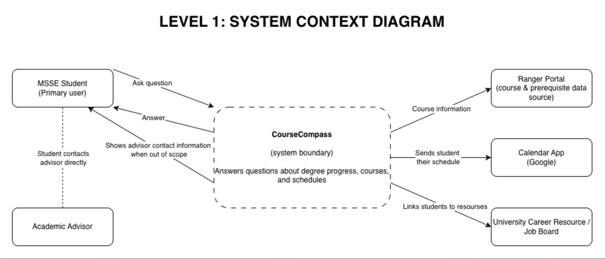
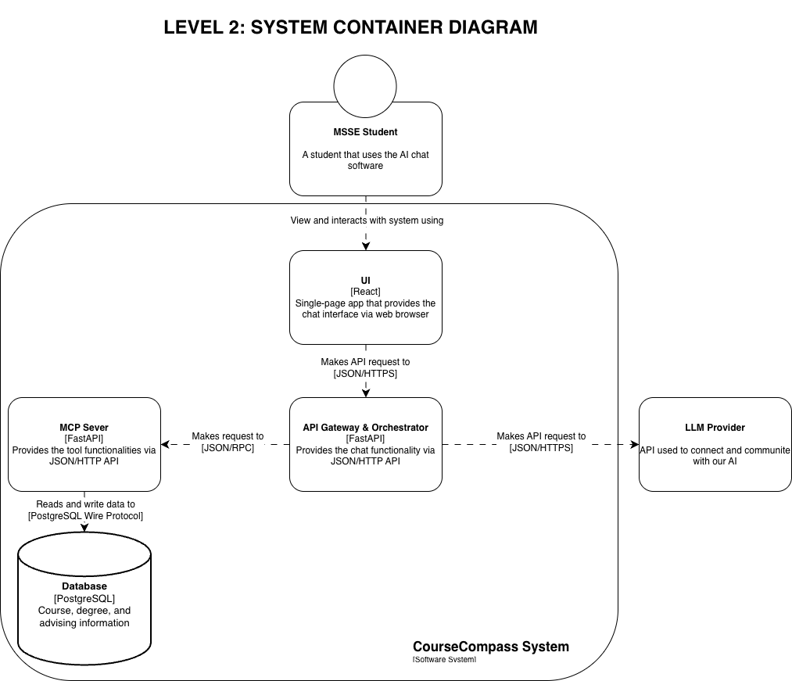
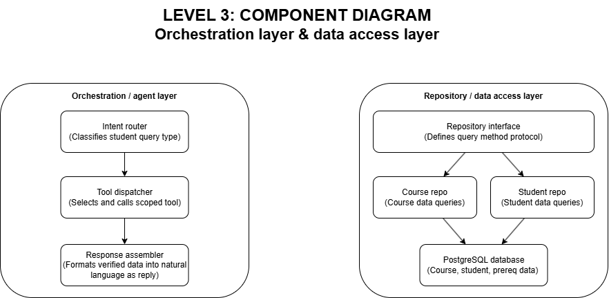

# Architecture Document

## Table of Contents

- [I. Executive Summary](#i-executive-summary)
- [II. Architectural Drivers Analysis](#ii-architectural-drivers-analysis)
- [III. Architecture Overview](#iii-architecture-overview)
- [IV. Architecture Views (C4 Model)](#iv-architecture-views-c4-model)
  - [Level 1: Context Diagram](#level-1-context-diagram)
  - [Level 2: Container Diagram](#level-2-container-diagram)
  - [Level 3: Component Diagram](#level-3-component-diagram)
- [V. Quality Attribute Achievement Strategy](#v-quality-attribute-achievement-strategy)
- [VI. Technology Selection Rationale](#vi-technology-selection-rationale)
- [VII. Architectural Constraints and Assumptions](#vii-architectural-constraints-and-assumptions)
- [VIII. Team Architecture Review Summary](#viii-team-architecture-review-summary)

---

## I. Executive Summary

Our team decided to build CourseCompass as a modular monolith to ensure delivery within the 2-week timeline. We use a layered architecture (API → orchestration → domain services → data access), a repository pattern that isolates PostgreSQL access, and an orchestrator/tool-calling pattern where the LLM routes each query to a predefined function rather than answering freely.

The key decision was to split the processing logic into two flows. One flow handles degree audit and credit calculations using pure functions that don't require the LLM. The other flow covers course/syllabus recommendations, relying on the LLM's reasoning ability combined with real data retrieved through pgvector. This protects answers that demand high academic accuracy from AI "hallucination."

This approach directly addresses our top quality attributes:

- **Reliability (QA-02):** all data is validated for accuracy through the Tool registry and Repository layer against the Course dataset
- **Performance (QA-01):** deterministic queries execute quickly through indexed, in-process calls, delivering instant responses to the frontend
- **Security (QA-03):** least-privilege scoping is enforced, ensuring only the requesting user's own data is returned, never another user's data, regardless of prompt injection attempts

The trade-offs we accepted include no independent scaling or runtime flexibility per module. Both of these are acceptable and deliberate choices at our current scale, since the tool functions are already MCP-compatible, meaning any future extraction will be an incremental improvement rather than a full rewrite.

---

## II. Architectural Drivers Analysis

### Driver 1: Reliability (QA-02)

QA-02 (Reliability) is the most important factor of the entire system. The reason behind this is that the trust of the user, the MSSE student, depends entirely on the accuracy of the information provided by the system. If a student receives unverified or inaccurate information about prerequisite courses and acts on it, this will lead to delays in completing required courses, additional tuition and living expenses, and a prolonged graduation timeline. Therefore, all factual information related to courses or prerequisites must be cross-checked against the verified dataset before being displayed to the user, and any information that cannot be verified will be redirected for handling instead of being answered directly.

### Driver 2: Performance (QA-01)

During course registration periods and add/drop periods, QA-01 (Performance) is the most important factor. If the tool for generating study plans operates slowly or freezes right when students are trying to plan for the next semester, they will lose trust in the tool at the most sensitive moment and may make unverified decisions. Therefore, the architecture needed to avoid the situations mentioned above must be decided at the architecture design stage.

### Driver 3: Security (QA-03)

QA-03 (Security) is a key factor because prompt injection is a widely documented attack method against any system that integrates an LLM. A successful attack could expose student data or cause the chatbot to provide inaccurate information about the academic program, thereby undermining the Reliability factor mentioned above. Therefore, the architecture needed to avoid the situations mentioned above must be decided at the architecture design stage.

---

## III. Architecture Overview

### Overall architectural style/pattern

- **Style:** Modular monolith
  - A single deployable application (with the exception of a decoupled front-end) internally organized into clearly bounded modules (audit, recommendations, scheduling, routing), rather than separate networked microservices. This allows us to accomplish development given our 8-week timeline and experience level, gives us more flexibility than a traditional monolith, and keeps the complexity to a minimum
- **Patterns:** Layered architecture; repository pattern; orchestrator/tool calling pattern
  - Layered architecture: API layer → orchestration layer → domain services → data access layer
  - Repository pattern: PostgreSQL accessed only through "middle man" layer so that domain logic doesn't need to be edited every time a new data source or course catalog is added
  - Orchestrator/tool calling pattern: The LLM layer (orchestrator) routes each query to already defined functions for accurate results.

### Key structural elements

- **Orchestration/agent layer**
  - Interprets student prompt, decides which tools to call, converts output into natural language
- **Tool Registry**
  - Functions that lead to calling a real database query
- **Degree audit engine**
  - Pre-defined prerequisite/credit logic to audit student's degree
- **Recommendation engine**
  - Semantic search of course syllabi using pgvector based on student's interests
- **Schedule builder + calendar export**
  - Generates recommended course schedule and exports it
- **Routing component**
  - Decides when to direct a student to external resources / who to direct to
- **Repository layer**
  - The "middle man" between the tool calls and the actual database, where the queries live
- **Course dataset**
  - All catalog info stored in PostgreSQL
- **Data ingestion module**
  - Process for loading and refreshing catalog data, ingests student transcripts
- **Decoupled frontend**
  - User interaction with application, communicates with backend over REST

### Integration approach

- **Frontend ↔ Backend:** REST API calls
- **Backend internals:** Direct function calls between layers
- **LLM ↔ Data:** Tool calling
- **Backend ↔ Database:** repository pattern over PostgreSQL

### Deployment architecture

- The application will be deployed within a mono repo, where it will be automatically shipped across two different deployments:
  - **Frontend:** The front end will be deployed on Vercel
  - **Backend:** The backend will be deployed on Google Cloud Run

---

## IV. Architecture Views (C4 Model)

### Level 1: Context Diagram

#### System Boundary: CourseCompass

The system that students interact with directly and connects with three external systems.

#### External Systems and Actors

- **MSSE Student (primary actor):** asks questions, receives plans and answers
- **Academic Advisor:** contacted directly by the student using the contact information CourseCompass surfaces when a question is out of scope
- **Ranger Portal:** Regis University's system; its course and prerequisite data is captured into our system, not accessed live
- **Google Calendar:** receives the student's exported schedule
- **University Career Resources / Job Board:** external destination the system links students to

#### Key Interactions

- A student asks a question and receives a plan or answer grounded in verified data
- When a question is out of scope, the system sends the advisor's contact information for the student to reach out directly, outside of the system
- A generated schedule is sent out to the student's own calendar app
- Relevant career resources are linked out based on the student's question

### Level 2: Container Diagram

#### Components

The system consists of 4 internal and 1 external component:

**Internal**

- **UI:** This is the way users interact with the application and receive responses.
- **API Gateway & Orchestrator:** This layer takes in the initial request and forwards it to the appropriate routing and tooling needed to complete the request.
- **MCP Server:** This layer provides tools to be used by the LLM and interacts between the database and Gateway layers.
- **Database:** The database layer persists our data and interacts with the MCP server to provide or store data.

**External**

- **LLM Provider:** The system uses an external LLM provider, and we will interact with its API using the Gateway/orchestration layer.

#### Technology Choice

- **React:** This is the front-end framework that will be used for our system
- **Python:** This language will support our backend systems.
- **Fast API:** This framework will be used to build out our orchestration and MCP server layers.

#### Communication protocols

- There will be three different protocols used within the system:
  - **JSON/HTTPS:** This is the protocol used between our UI → API Gateway layer and API Gateway → LLM Provider layer
  - **JSON/RPC:** This is the communication protocol between our MCP Server → API Gateway layer
  - **PostgreSQL Wire Protocol:** This is the protocol used to transfer data between our MCP Server → Database

#### Audience

- This diagram's audience is software engineers and developers. They will use it to determine the relationship between the different components of the system, both internal and external.

### Level 3: Component Diagram

#### Orchestration / agent layer

This layer handles every student query and makes sure the LLM never touches student or course data directly. The intent router figures out what the prompt from the student is asking for. The tool dispatcher then calls the one matching function for that request and gets back a verified result. The response assembler turns that result into a natural language sounding reply, without adding anything the tool didn't return.

#### Repository / data access layer

This layer is the only part of the system that reaches PostgreSQL directly. The repository interface lists the methods available (like "get prerequisites" or "get completed courses"). The course repository and student repository are what run the actual queries and bring back data. Because domain code only ever calls the interface, swapping in a new data source later just means writing a new method or implementation here, with nothing else in the app needing to change.

---

## V. Quality Attribute Achievement Strategy

### QA Scenario QA-01: Performance

**Architectural Tactics Applied**

- **Indexed data access:** the Repository layer runs against indexed Course dataset queries rather than being recomputed on every request.
- **Bounded LLM use:** the Orchestration / Agent layer only parses intent and selects a tool, not for generating factual content
- **In-process tool dispatch:** the Tool registry calls domain services like the Degree audit engine as direct function calls
- **Immediate acknowledgement:** the Decoupled frontend displays a processing indicator within 1 second

**Supporting Architecture Elements**

- Orchestration / Agent layer
- Repository layer
- Tool registry
- Decoupled frontend

**How This Achieves the Scenario**

When a student submits a roadmap prompt (stimulus) under peak load of 50+ concurrent users, the Decoupled frontend shows a processing indicator within 1 second while the Orchestration / Agent parses intent and hands off to the Tool registry to call the Degree audit engine. The Repository layer resolves that request with indexed queries against the Course dataset rather than waiting on slow LLM-generated content for facts. These tactics keep 95% of responses under 5 seconds and no more than 10, satisfying QA-01's response measure.

### QA Scenario QA-02: Reliability

**Architectural Tactics Applied**

- **Dataset access only:** the Orchestration / Agent layer can't emit factual claims directly; it can only request a lookup, and the Degree audit engine is the sole source of factual answers
- **Fact-verification gate:** every course/prerequisite claim is resolved through the Repository layer against the Course dataset before being displayed to the user
- **Redirect tactic:** if there is an out-of-scope question or any question not in the Course dataset, the Routing component defaults to redirect (academic advisor contact information) instead of guessing

**Supporting Architecture Elements**

- Orchestration / Agent layer
- Tool registry
- Repository layer
- Routing component

**How This Achieves the Scenario**

When a student asks a question outside of the system's scope (stimulus), the Orchestration / Agent layer recognizes the question can't be answered by the LLM. Since the Tool registry only exposes the Degree audit engine's verified function, the Routing component then intercepts this case and triggers the redirect tactic, sending the academic advisor's contact information so the student can follow up directly instead of displaying an unverified answer. Because every course / prerequisite claim is required to pass through the Repository layer before display, 100% of shown facts are validated by construction, satisfying QA-02's response measure.

### QA Scenario QA-03: Security

**Architectural Tactics Applied**

- **Restricted execution surface:** The LLM may only use a fixed set of tool calls
- **Least privilege scoping:** Each tool function is single-purpose and can only return the own student's data, not capable of returning other student's data even with prompt injection
- **Input/output segregation:** User input and retrieved data are always treated as data, never as new system instructions
- **System prompt isolation:** Core instructions are not included in any context returned to the user
- **Logging and monitoring:** Every tool call and flagged input is logged with student ID, timestamp, and query for later review

**Supporting Architecture Elements**

- Orchestration/agent layer
- Tool registry
- Repository layer
- Logging store

**How This Achieves the Scenario**

When a student submits a query containing an injected instruction (stimulus), the orchestration layer still restricts the scope to only selecting from a fixed tool set and continues to operate within its bounds. Because the LLM has no mechanism to execute actions outside of tool calling, there is no way to escalate privileges. The attempted injection event is logged, and the response to the user is limited to whatever a legitimate tool call would return.

### QA Scenario QA-04: Modifiability

**Architectural Tactics Applied**

- **Decoupled frontend and backend:** The loose coupling in the separation of the UI business rules and AI API enables quick changes or modifications on one layer without breaking another.
- **Interface abstraction:** Using an MCP server enables us to interact with other AI vendors as needed, but still maintaining the tools that we already established and developed.

**Supporting Architecture Elements**

- React
- Fast API Modular Monolith
- MCP SDK

**How This Achieves the Scenario**

When a developer needs to change the AI vendor from Claude to OpenAI due to cost or performance reasons (Stimulus), a developer updates the call and configurations from the backend to the OpenAI API. Since the frontend is decoupled from the backend, and the backend is a modular monolith, the separation between layers allows us to modify the vendors used without rewriting the entire application. This meets our modifiability requirement, keeping changes under eight developer hours and requiring less than three file changes.

---

## VI. Technology Selection Rationale

### Programming languages/frameworks

- **React**
  - The team has the most experience with this framework for our front end. Using React will enable us to get hands-on experience with an industry-level tool and create modifiable components within our user interface, which will help satisfy our quality attribute of modifiability within our system.
- **Python**
  - Python was the team's language of choice because of its widespread use in AI. Since this is our team's first time developing with this type of technology, to make the integration of AI in our software as easy as possible, we needed a language that would require the least amount of workarounds. The team also has some experience with the language, which lets us spend more time learning other tools.
- **Fast API**
  - Although the team has no experience with this back-end framework, FastAPI is known for high concurrency, speed, documentation capabilities, and built-in data validation. This will be a powerful framework to support our software needs, without extra add-ons or installations.

### Database choices (relational, NoSQL, caching) and rationale

- **PostgreSQL with pgvector**
  - The team has used SQL in some capacity, so we chose a database based on how the technology could support our solution. PostgreSQL is open source, meaning it has extensive documentation and community support. pgvector enables vector search, which will be powerful when combined with our AI.

### Infrastructure/deployment platform (cloud provider, containers, serverless)

- **Cloud Provider**
  - **Vercel:** Even though our team has no experience with Platform as a Service (PaaS), it offers a free tier that will be sufficient to host our frontend. It also provides automatic builds and deployments from our repo, which will help ease the workload on our team
  - **Cloud GCP:** Our team wants hands-on experience with industry cloud tools, and GCP is our platform of choice. Its wide range of services and free student tier are enough to support our software needs.

### Integration technologies (REST, GraphQL, message queues, gRPC)

- **REST**
  - We will use REST to interface with our APIs. It is the communication protocol that our team has the most experience building APIs with.
- **JSON-RPC 2.0**
  - This will be used to communicate with our MCP/Orchestrator layer between our tools and AI API. This is the standard way to communicate within this type of architecture.
- **PostgreSQL Wire Protocol**
  - This is the standard to use between our persistence layer and our backend business layer.

---

## VII. Architectural Constraints and Assumptions

### Constraints

- **Timeline:**
  - Because the term is only eight weeks, the team has very limited time for implementation. This requires us to be extremely efficient and direct in the tasks that we take on and complete. This limited the architecture's complexity, as we needed a design that let us work quickly and avoid a steep learning curve.
- **Team skills:**
  - The team has limited experience with the technology we are using. This may be an obstacle as we learn new technologies quickly and find a workflow that supports collaboration and timely delivery. To focus on learning the needed technologies, we chose an architecture that supported our team's current skill set.
- **Budget:**
  - Our team has only three people, and we do not have external funding for this project. This limits the paid options for the technologies and services we can use to build our solution. Our current architecture supports free-tier offerings from our cloud service provider.

### Assumptions

- **Limited User Base:**
  - The main assumption driving our solution's priority is our limited user base. Our first iteration aims to serve MSSE students and their degree requirements, capping the scope and use cases of our software. This also sets realistic expectations for the scale of our project and the number of users we can support in this development cycle.
- **High Availability of our 3rd party services:**
  - Our architecture is extremely reliant on the availability of the services that we use. We are deploying on GCP, assuming that the Cloud-based platform will be accessible for all team members during development at any time. We also use a third-party AI API that supports the most important component of our software. We assume the service will be available at a high enough rate to support a stress-free user experience.

### Risks

- **Lower reliability of our services:**
  - **Effect:**
    - Because our architecture is cloud-based and uses third-party APIs, any downtime on their end could shut down our application completely, preventing users from accessing it.
  - **Mitigation Strategy:**
    - Using the scalability offered by our cloud provider, we can spin up additional deployments to increase application availability. If the AI is completely unavailable, we can implement a safeguard by shutting down all requests and enabling only non-AI features.
- **Hallucination of our AI:**
  - **Effect:**
    - Introducing AI and our architecture design introduces a major risk of hallucinations and providing the wrong information to our users.
  - **Mitigation Strategy:**
    - We will test the AI's accuracy before our initial rollout. To protect our users, we will include a disclaimer before use that AI is not always correct and that users should double-check the responses. While we will implement guardrails, we will also offer optional feedback so users can flag inaccurate responses and help us build better guardrails. Many features will also be deterministic and determined without AI, such as degree progress and course completions.

---

## VIII. Team Architecture Review Summary

On Thursday, September 10, and Friday, September 11, all members held a discussion on Slack about the architecture to be designed (part III) and technologies to be used (part VI) to build CourseCompass. After a day of research, the members proposed the architecture and technology choices best suited to the project. After the discussion, all members agreed with the choices presented above.
