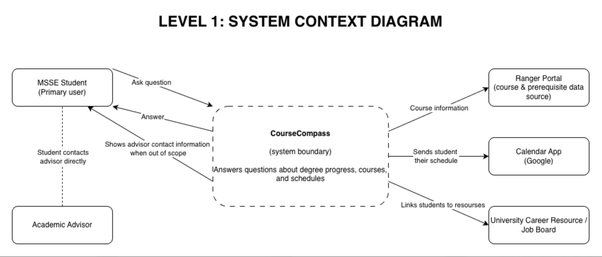
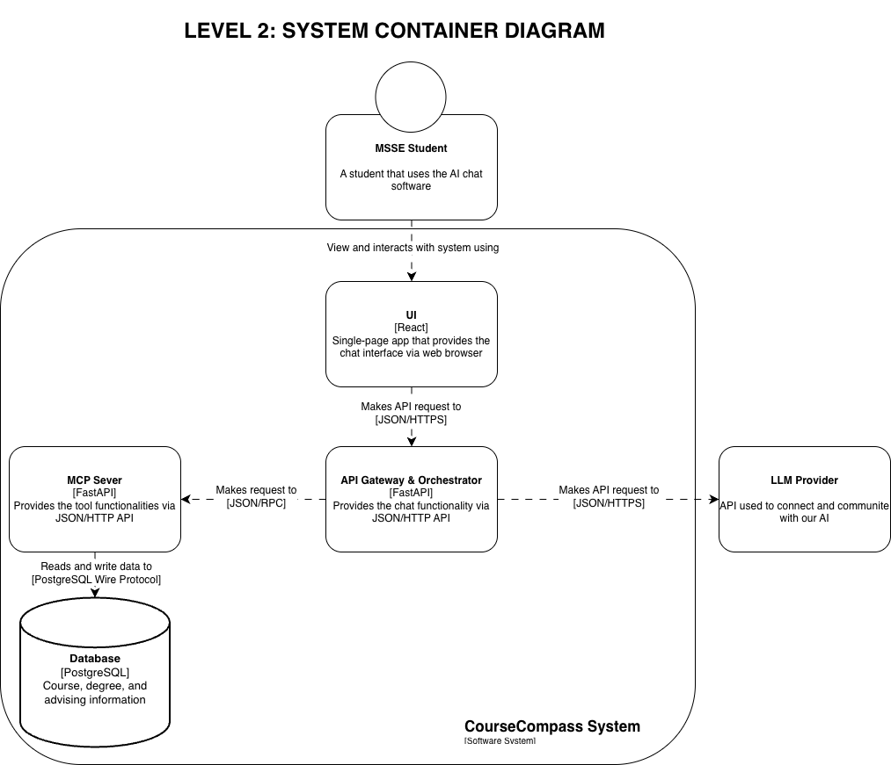
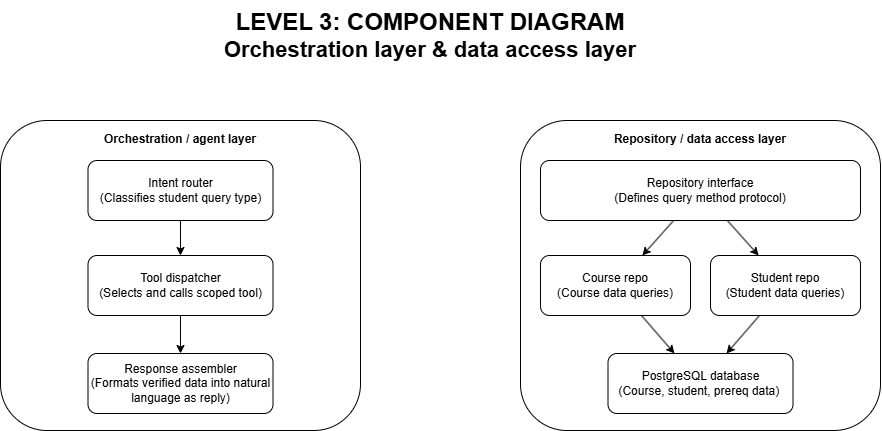

# Architecture Document

## Table of Contents

- [I. Executive Summary](#i-executive-summary)
- [II. Architectural Drivers Analysis](#ii-architectural-drivers-analysis)
- [III. Architecture Overview](#iii-architecture-overview)
- [IV. Architecture Views (C4 Model)](#iv-architecture-views-c4-model)
  - [Level 1: Context Diagram](#level-1-context-diagram)
  - [Level 2: Container Diagram](#level-2-container-diagram)
  - [Level 3: Component Diagram](#level-3-component-diagram)
- [V. Quality Attribute Achievement Strategy](#v-quality-attribute-achievement-strategy)
- [VI. Technology Selection Rationale](#vi-technology-selection-rationale)
- [VII. Architectural Constraints and Assumptions](#vii-architectural-constraints-and-assumptions)
- [VIII. Team Architecture Review Summary](#viii-team-architecture-review-summary)

---

## I. Executive Summary

Our team decided to build CourseCompass as a modular monolith to ensure delivery within the 2-week timeline. We use a layered architecture (API → orchestration → domain services → data access), a repository pattern that isolates PostgreSQL access, and an orchestrator/tool-calling pattern where the LLM routes each query to a predefined function rather than answering freely.

The key decision was to split the processing logic into two flows. One flow handles degree audit and credit calculations using pure functions that don't require the LLM. The other flow covers course/syllabus recommendations, relying on the LLM's reasoning ability combined with real data retrieved through pgvector. This protects answers that demand high academic accuracy from AI "hallucination."

This approach directly addresses our top quality attributes:

- **Reliability (QA-02):** all data is validated for accuracy through the Tool registry and Repository layer against the Course dataset
- **Performance (QA-01):** deterministic queries execute quickly through indexed, in-process calls, delivering instant responses to the frontend
- **Security (QA-03):** least-privilege scoping is enforced, ensuring only the requesting user's own data is returned, never another user's data, regardless of prompt injection attempts

The trade-offs we accepted include no independent scaling or runtime flexibility per module. Both of these are acceptable and deliberate choices at our current scale, since the tool functions are already MCP-compatible, meaning any future extraction will be an incremental improvement rather than a full rewrite.

---

## II. Architectural Drivers Analysis

### Driver 1: Reliability (QA-02)

QA-02 (Reliability) is the most important factor of the entire system. The reason behind this is that the trust of the user, the MSSE student, depends entirely on the accuracy of the information provided by the system. If a student receives unverified or inaccurate information about prerequisite courses and acts on it, this will lead to delays in completing required courses, additional tuition and living expenses, and a prolonged graduation timeline. Therefore, all factual information related to courses or prerequisites must be cross-checked against the verified dataset before being displayed to the user, and any information that cannot be verified will be redirected for handling instead of being answered directly.

### Driver 2: Performance (QA-01)

During course registration periods and add/drop periods, QA-01 (Performance) is the most important factor. If the tool for generating study plans operates slowly or freezes right when students are trying to plan for the next semester, they will lose trust in the tool at the most sensitive moment and may make unverified decisions. Therefore, the architecture needed to avoid the situations mentioned above must be decided at the architecture design stage.

### Driver 3: Security (QA-03)

QA-03 (Security) is a key factor because prompt injection is a widely documented attack method against any system that integrates an LLM. A successful attack could expose student data or cause the chatbot to provide inaccurate information about the academic program, thereby undermining the Reliability factor mentioned above. Therefore, the architecture needed to avoid the situations mentioned above must be decided at the architecture design stage.

---

## III. Architecture Overview

### Overall architectural style/pattern

- **Style:** Modular monolith
  - A single deployable application (with the exception of a decoupled front-end) internally organized into clearly bounded modules (audit, recommendations, scheduling, routing), rather than separate networked microservices. This allows us to accomplish development given our 8-week timeline and experience level, gives us more flexibility than a traditional monolith, and keeps the complexity to a minimum
- **Patterns:** Layered architecture; repository pattern; orchestrator/tool calling pattern
  - Layered architecture: API layer → orchestration layer → domain services → data access layer
  - Repository pattern: PostgreSQL accessed only through "middle man" layer so that domain logic doesn't need to be edited every time a new data source or course catalog is added
  - Orchestrator/tool calling pattern: The LLM layer (orchestrator) routes each query to already defined functions for accurate results.

### Key structural elements

- **Orchestration/agent layer** (`backend/app/orchestration/`)
  - `mock_query.answer_query` handles each `/api/v1/query` request. It sends the question and recent history to the LLM provider (Vertex AI Gemini), which chooses a tool through function calling. The tool dispatcher runs that tool, and the LLM turns the verified result into a reply. A mock path returns canned answers when no live provider is configured.
  - `intent_router.py` and `response_assembler.py` are placeholders that raise `NotImplementedError`. They are not used by the live query path.
- **Tool Registry and dispatcher** (`tool_catalog.py`, `tool_dispatcher.py`, `tools/mcp_tools.py`)
  - Eight tools the LLM can call: `audit_degree`, `build_schedule`, `get_advisor_contact`, `get_career_services`, `get_course_description`, `get_next_milestones`, `list_term_offerings`, `recommend_courses`
  - Each tool calls a service or repository method. The LLM never receives raw database access.
- **Degree audit service** (`services/audit_service.py`)
  - Deterministic prerequisite and credit logic. Counts completed and in-progress transcript rows, and a substitute course counts only once it is completed or in progress
- **Course substitutions** (`services/substitution_service.py`)
  - Lets a student propose a substitute for a required course. Equivalencies are stored in the database
- **Course catalog and recommendations** (`services/course_catalog_service.py`)
  - Course lookup and semantic search of syllabus chunks using pgvector, via `embeddings/` providers (Vertex AI embeddings)
- **Schedule builder** (`scheduling/`, `api/v1/schedule.py`)
  - Builds a draft schedule from the student's remaining requirements and offerings, and lists schedules
  - Export only marks a schedule as exported. The backend does not integrate with Google Calendar or any other calendar service
- **Student milestones, campus directory and advisor contacts** (`services/student_milestone_service.py`, `services/campus_directory_service.py`)
  - Next-milestone guidance and the advisor and career-service information returned by the `get_advisor_contact` and `get_career_services` tools
- **Transcript upload and ingestion** (`ingestion/`, `api/v1/transcript.py`, `api/v1/admin_ingest.py`)
  - Parses student transcript PDFs and stores completed and in-progress rows. A grade must be a C or better to count as passing; C-, D and F rows are not stored as completed
  - Admin endpoints load and refresh catalog data and record ingestion logs
- **Student provisioning and Clerk webhooks** (`services/student_provisioning_service.py`, `api/v1/clerk_webhook.py`)
  - Creates student records when a Clerk user signs up
- **Authentication** (`auth/clerk_auth.py`)
  - Verifies Clerk session tokens (JWKS). Each request is scoped to the signed-in student's own data. A dev-only `X-Dev-Student-Id` header is honored only when `APP_ENV` is `local`, `staging` or `test`
- **Repository layer** (`repositories/`)
  - Interfaces in `interfaces.py`, with PostgreSQL implementations (`postgres_*.py`). Domain code only calls the interfaces
- **Course dataset**
  - Catalog, prerequisites, requirements, offerings, terms and syllabus chunks, all stored in PostgreSQL with pgvector. The schema is managed by 19 migrations in `migrations/`
- **Decoupled frontend** (`frontend/`)
  - React 19 with Vite. Talks to the backend over REST. Uses Clerk for sign-in, or a dev-mode user when no Clerk key is set. A mock API client can replace the backend for local work

### Integration approach

- **Frontend ↔ Backend:** REST API calls (`/api/v1/...`) with Clerk session tokens
- **Backend internals:** Direct function calls between layers
- **LLM ↔ Data:** Gemini function calling. The model picks a tool, and the backend runs it
- **Backend ↔ Database:** Repository pattern over PostgreSQL, connected through `DATABASE_URL`
- **Clerk ↔ Backend:** Signed webhooks (Svix) create or update student records

### Deployment architecture

- The application lives in one monorepo, with two deployable parts:
  - **Frontend:** Deployed on Vercel
  - **Backend:** A Docker image (`backend/Dockerfile`, Python 3.12) deployed to Google Cloud Run in `us-central1`, built with Cloud Build and stored in Artifact Registry. `scripts/deploy-backend.sh` runs the build and deploy by hand. There are two services: `coursecompass-api` (production) and `coursecompass-api-dev` (development). The deploy script is not triggered automatically.
  - **Database:** PostgreSQL with pgvector, reached through `DATABASE_URL`
- **Continuous integration:** GitHub Actions (`.github/workflows/ci.yml`) runs backend pytest, database tests against Postgres with pgvector, Docker build, frontend Vitest and build, and Playwright end-to-end tests. CI does not deploy.

---

## IV. Architecture Views (C4 Model)

### Level 1: Context Diagram

#### System Boundary: CourseCompass

The system that students interact with directly and connects with three external systems.

#### External Systems and Actors

- **MSSE Student (primary actor):** asks questions, receives plans and answers
- **Academic Advisor:** contacted directly by the student using the contact information CourseCompass surfaces when a question is out of scope
- **Ranger Portal:** Regis University's system; its course and prerequisite data is captured into our system, not accessed live
- **Clerk:** signs students in and sends user-created webhooks to the backend
- **Google Calendar:** Not integrated. Exporting a schedule only marks it as exported in CourseCompass
- **University Career Resources / Job Board:** external destination the system links students to

#### Key Interactions

- A student asks a question and receives a plan or answer grounded in verified data
- When a question is out of scope, the system sends the advisor's contact information for the student to reach out directly, outside of the system
- A generated schedule is sent out to the student's own calendar app
- Relevant career resources are linked out based on the student's question

### Level 2: Container Diagram

#### Components

The system consists of 4 internal and 3 external components:

**Internal**

- **UI:** React single-page app (Vercel). Users sign in with Clerk and interact with the chatbot, transcript upload, substitutions and schedule builder.
- **API Gateway & Orchestrator:** FastAPI service that authenticates the request, runs the LLM tool-calling loop and returns the reply. Also hosts the transcript, schedule and Clerk webhook endpoints (Cloud Run).
- **Tool layer (MCP-style tools):** The tool catalog and dispatcher that the LLM calls. Each tool runs a service or repository method. The tools are MCP-compatible in shape, but they run in-process and are not a separate MCP server.
- **Database:** PostgreSQL with pgvector. Stores the catalog, student records, transcripts, substitutions, schedules and syllabus embeddings.

**External**

- **LLM Provider:** Vertex AI Gemini (`gemini-2.5-flash` by default), called through function calling.
- **Embedding Provider:** Vertex AI embeddings (`gemini-embedding-001`), used for syllabus search.
- **Clerk:** Authentication and user management. Sends `user.created` webhooks to the backend.

#### Technology Choice

- **React 19 with Vite:** Front-end framework and build tool, with Vitest and Playwright for tests
- **Python 3.12 (Docker image):** Backend language
- **FastAPI:** Backend API framework, serving the orchestration and tool layers
- **PostgreSQL with pgvector:** Relational store and vector search
- **Clerk:** Sign-in and session tokens
- **Google Cloud:** Cloud Run (API), Cloud Build and Artifact Registry (images), Vertex AI (LLM and embeddings)

#### Communication protocols

- Three protocols are used within the system:
  - **JSON/HTTPS:** UI → API (REST under `/api/v1`), and API → Vertex AI
  - **Function calling:** The LLM selects a tool, and the backend runs it in-process. There is no JSON-RPC server
  - **PostgreSQL Wire Protocol:** Backend → database

#### Audience

- This diagram's audience is software engineers and developers. They will use it to determine the relationship between the different components of the system, both internal and external.

### Level 3: Component Diagram

#### Orchestration / agent layer

This layer handles every student query and keeps the LLM away from raw student or course data. `answer_query` sends the question and recent history to the LLM with the tool definitions. The LLM chooses one tool, the tool dispatcher runs it with the signed-in student's ID, and the verified result goes back to the LLM so it can write the reply. Out-of-scope questions are sent to advisor or career-service information rather than answered directly.

The intent router and response assembler exist as interfaces only. They are not used at runtime, and the LLM's function choice replaces the intent router.

#### Repository / data access layer

This layer is the only part of the system that reaches PostgreSQL directly. The repository interface lists the methods available (like "get prerequisites" or "get completed courses"). The course repository and student repository are what run the actual queries and bring back data. Because domain code only ever calls the interface, swapping in a new data source later just means writing a new method or implementation here, with nothing else in the app needing to change.

---

## V. Quality Attribute Achievement Strategy

### QA Scenario QA-01: Performance

**Architectural Tactics Applied**

- **Indexed data access:** the Repository layer runs against indexed Course dataset queries rather than being recomputed on every request.
- **Bounded LLM use:** the Orchestration / Agent layer only parses intent and selects a tool, not for generating factual content
- **In-process tool dispatch:** the Tool registry calls domain services like the Degree audit engine as direct function calls
- **Immediate acknowledgement:** the Decoupled frontend displays a processing indicator within 1 second

**Supporting Architecture Elements**

- Orchestration / Agent layer
- Repository layer
- Tool registry
- Decoupled frontend

**How This Achieves the Scenario**

When a student submits a roadmap prompt (stimulus) under peak load of 50+ concurrent users, the Decoupled frontend shows a processing indicator within 1 second while the Orchestration / Agent parses intent and hands off to the Tool registry to call the Degree audit engine. The Repository layer resolves that request with indexed queries against the Course dataset rather than waiting on slow LLM-generated content for facts. These tactics keep 95% of responses under 5 seconds and no more than 10, satisfying QA-01's response measure.

### QA Scenario QA-02: Reliability

**Architectural Tactics Applied**

- **Dataset access only:** the Orchestration / Agent layer can't emit factual claims directly; it can only request a lookup, and the Degree audit engine is the sole source of factual answers
- **Fact-verification gate:** every course/prerequisite claim is resolved through the Repository layer against the Course dataset before being displayed to the user
- **Redirect tactic:** if there is an out-of-scope question or any question not in the Course dataset, the Routing component defaults to redirect (academic advisor contact information) instead of guessing

**Supporting Architecture Elements**

- Orchestration / Agent layer
- Tool registry
- Repository layer
- Routing component

**How This Achieves the Scenario**

When a student asks a question outside of the system's scope (stimulus), the Orchestration / Agent layer recognizes the question can't be answered by the LLM. Since the Tool registry only exposes the Degree audit engine's verified function, the Routing component then intercepts this case and triggers the redirect tactic, sending the academic advisor's contact information so the student can follow up directly instead of displaying an unverified answer. Because every course / prerequisite claim is required to pass through the Repository layer before display, 100% of shown facts are validated by construction, satisfying QA-02's response measure.

### QA Scenario QA-03: Security

**Architectural Tactics Applied**

- **Restricted execution surface:** The LLM may only use a fixed set of tool calls
- **Least privilege scoping:** Each tool function is single-purpose and can only return the own student's data, not capable of returning other student's data even with prompt injection
- **Input/output segregation:** User input and retrieved data are always treated as data, never as new system instructions
- **System prompt isolation:** Core instructions are not included in any context returned to the user
- **Logging and monitoring:** Every tool call and flagged input is logged with student ID, timestamp, and query for later review

**Supporting Architecture Elements**

- Orchestration/agent layer
- Tool registry
- Repository layer
- Logging store

**How This Achieves the Scenario**

When a student submits a query containing an injected instruction (stimulus), the orchestration layer still restricts the scope to only selecting from a fixed tool set and continues to operate within its bounds. Because the LLM has no mechanism to execute actions outside of tool calling, there is no way to escalate privileges. The attempted injection event is logged, and the response to the user is limited to whatever a legitimate tool call would return.

### QA Scenario QA-04: Modifiability

**Architectural Tactics Applied**

- **Decoupled frontend and backend:** The loose coupling in the separation of the UI business rules and AI API enables quick changes or modifications on one layer without breaking another.
- **Interface abstraction:** Using an MCP server enables us to interact with other AI vendors as needed, but still maintaining the tools that we already established and developed.

**Supporting Architecture Elements**

- React
- Fast API Modular Monolith
- MCP SDK

**How This Achieves the Scenario**

When a developer needs to change the AI vendor from Claude to OpenAI due to cost or performance reasons (Stimulus), a developer updates the call and configurations from the backend to the OpenAI API. Since the frontend is decoupled from the backend, and the backend is a modular monolith, the separation between layers allows us to modify the vendors used without rewriting the entire application. This meets our modifiability requirement, keeping changes under eight developer hours and requiring less than three file changes.

---

## VI. Technology Selection Rationale

### Programming languages/frameworks

- **React**
  - The team has the most experience with this framework for our front end. Using React will enable us to get hands-on experience with an industry-level tool and create modifiable components within our user interface, which will help satisfy our quality attribute of modifiability within our system.
- **Python**
  - Python was the team's language of choice because of its widespread use in AI. Since this is our team's first time developing with this type of technology, to make the integration of AI in our software as easy as possible, we needed a language that would require the least amount of workarounds. The team also has some experience with the language, which lets us spend more time learning other tools.
- **Fast API**
  - Although the team has no experience with this back-end framework, FastAPI is known for high concurrency, speed, documentation capabilities, and built-in data validation. This will be a powerful framework to support our software needs, without extra add-ons or installations.

### Database choices (relational, NoSQL, caching) and rationale

- **PostgreSQL with pgvector**
  - The team has used SQL in some capacity, so we chose a database based on how the technology could support our solution. PostgreSQL is open source, meaning it has extensive documentation and community support. pgvector enables vector search, which will be powerful when combined with our AI.

### Infrastructure/deployment platform (cloud provider, containers, serverless)

- **Cloud Provider**
  - **Vercel:** Even though our team has no experience with Platform as a Service (PaaS), it offers a free tier that will be sufficient to host our frontend. It also provides automatic builds and deployments from our repo, which will help ease the workload on our team
  - **Cloud GCP:** Our team wants hands-on experience with industry cloud tools, and GCP is our platform of choice. Cloud Run hosts the API (production and development services), Cloud Build and Artifact Registry build the images, and Vertex AI provides the LLM and embeddings.
- **Identity:** Clerk for sign-in and session tokens, verified by the backend.
- **Testing and CI:** pytest, Vitest, Playwright, and GitHub Actions.

### Integration technologies (REST, GraphQL, message queues, gRPC)

- **REST**
  - We will use REST to interface with our APIs. It is the communication protocol that our team has the most experience building APIs with.
- **Function calling (Gemini)**
  - The LLM calls the tools through Vertex AI function calling. The backend runs the tool in-process. We chose this over a JSON-RPC server to keep deployment to one service.
- **PostgreSQL Wire Protocol**
  - This is the standard to use between our persistence layer and our backend business layer.

---

## VII. Architectural Constraints and Assumptions

### Constraints

- **Timeline:**
  - Because the term is only eight weeks, the team has very limited time for implementation. This requires us to be extremely efficient and direct in the tasks that we take on and complete. This limited the architecture's complexity, as we needed a design that let us work quickly and avoid a steep learning curve.
- **Team skills:**
  - The team has limited experience with the technology we are using. This may be an obstacle as we learn new technologies quickly and find a workflow that supports collaboration and timely delivery. To focus on learning the needed technologies, we chose an architecture that supported our team's current skill set.
- **Budget:**
  - Our team has only three people, and we do not have external funding for this project. This limits the paid options for the technologies and services we can use to build our solution. Our current architecture supports free-tier offerings from our cloud service provider.

### Assumptions

- **Limited User Base:**
  - The main assumption driving our solution's priority is our limited user base. Our first iteration aims to serve MSSE students and their degree requirements, capping the scope and use cases of our software. This also sets realistic expectations for the scale of our project and the number of users we can support in this development cycle.
- **High Availability of our 3rd party services:**
  - Our architecture is extremely reliant on the availability of the services that we use. We are deploying on GCP, assuming that the Cloud-based platform will be accessible for all team members during development at any time. We also use a third-party AI API that supports the most important component of our software. We assume the service will be available at a high enough rate to support a stress-free user experience.

### Risks

- **Lower reliability of our services:**
  - **Effect:**
    - Because our architecture is cloud-based and uses third-party APIs, any downtime on their end could shut down our application completely, preventing users from accessing it.
  - **Mitigation Strategy:**
    - Using the scalability offered by our cloud provider, we can spin up additional deployments to increase application availability. If the AI is completely unavailable, we can implement a safeguard by shutting down all requests and enabling only non-AI features.
- **Hallucination of our AI:**
  - **Effect:**
    - Introducing AI and our architecture design introduces a major risk of hallucinations and providing the wrong information to our users.
  - **Mitigation Strategy:**
    - We will test the AI's accuracy before our initial rollout. To protect our users, we will include a disclaimer before use that AI is not always correct and that users should double-check the responses. While we will implement guardrails, we will also offer optional feedback so users can flag inaccurate responses and help us build better guardrails. Many features will also be deterministic and determined without AI, such as degree progress and course completions.

---

## VIII. Team Architecture Review Summary

On Thursday, September 10, and Friday, September 11, all members held a discussion on Slack about the architecture to be designed (part III) and technologies to be used (part VI) to build CourseCompass. After a day of research, the members proposed the architecture and technology choices best suited to the project. After the discussion, all members agreed with the choices presented above.
