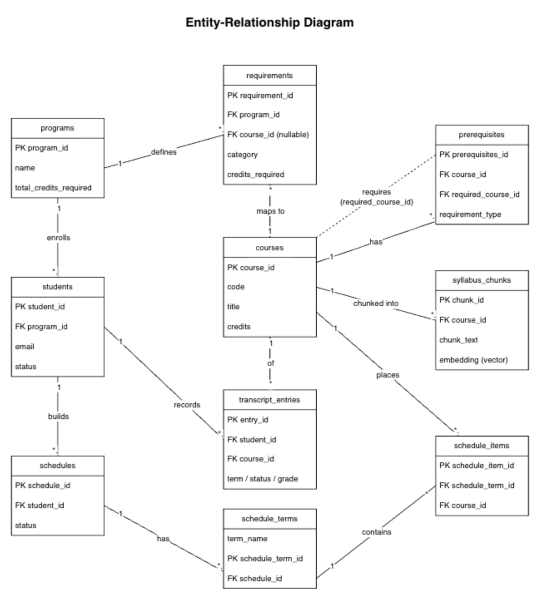
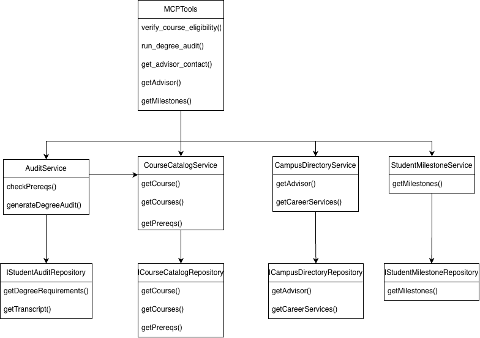
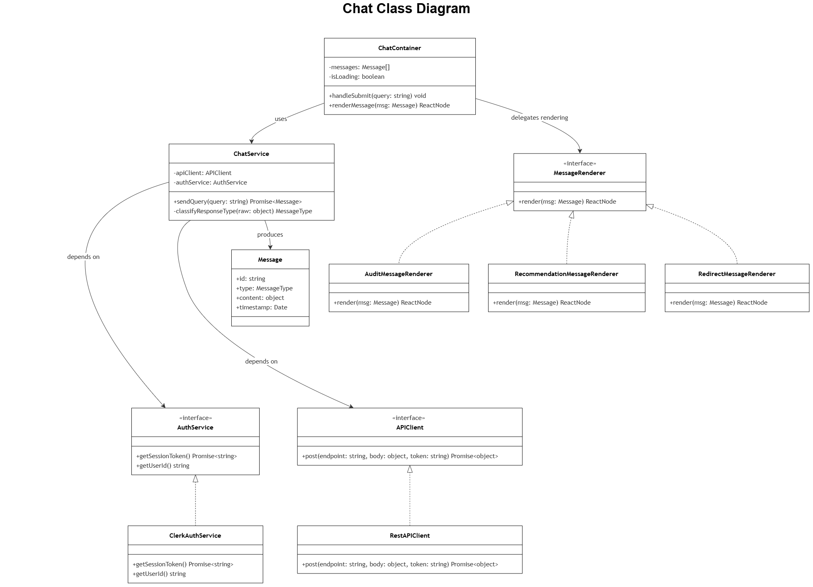
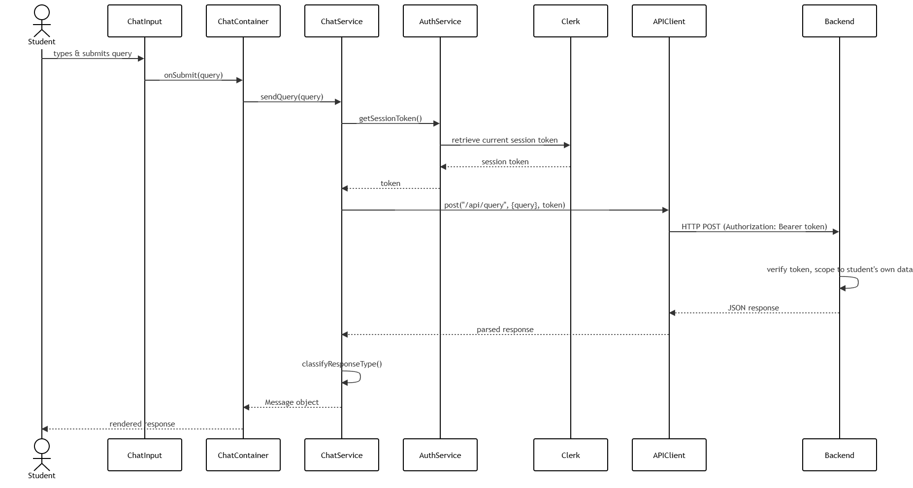

# Detailed Design

## Table of Contents

- [I. API Specifications](#i-api-specifications)
  - [REST API](#rest-api)
  - [Error handling](#error-handling)
  - [API versioning](#api-versioning)
  - [Rate limit](#rate-limit)
- [II. Data Model & Schema Design](#ii-data-model--schema-design)
  - [Entity-Relationship Diagram](#entity-relationship-diagram)
  - [Database Schema](#database-schema)
  - [Indexes](#indexes)
  - [Migration Strategy](#migration-strategy)
  - [Data Access Patterns](#data-access-patterns)
- [III. Technology Stack Documentation](#iii-technology-stack-documentation)
  - [Programming languages/frameworks](#programming-languagesframeworks)
  - [Database choices](#database-choices)
  - [Third-Party Libraries](#third-party-libraries)
  - [Infrastructure/deployment platform](#infrastructuredeployment-platform-cloud-provider-containers-serverless)
  - [Development tools](#development-tools)
- [IV. Component Internal Design](#iv-component-internal-design)
  - [MCP Internal Component](#mcp-internal-component)
  - [Chat Internal Component](#chat-internal-component)
- [V. Quality Attribute Design Strategies](#v-quality-attribute-design-strategies)
- [VI. Implementation Guidance](#vi-implementation-guidance)

---

## I. API Specifications

### REST API

#### Frontend ↔ backend

`POST /api/v1/query`

Request:

```json
{
  "query": "string (required) — the student's natural-language question"
}
```

Response (200 OK):

```json
{
  "id": "string — unique message ID",
  "type": "audit | recommendation | redirect",
  "content": {
    "// shape varies by type, e.g. for audit:": "",
    "creditsRemaining": "number",
    "requirementsMet": "boolean",
    "missingCourses": ["string"]
  },
  "timestamp": "string (ISO 8601)"
}
```

#### Frontend ↔ Clerk (auth)

Clerk is accessed through its official React SDK (`@clerk/clerk-react`), not through custom-built endpoints.

#### Backend

`POST /api/v1/admin/ingest/course`

- Request: multipart file upload (CSV/JSON) (course, prerequisite, and requirement records)
- Response: `202 Accepted`

`GET /api/v1/admin/ingest/status/{job_id}`

- Response: `200 OK`, `{ job_id, status: 'running'|'succeeded'|'failed', records_processed, error_message? }`
- `404` if `job_id` not found

`POST /api/v1/admin/ingest/transcripts`

- Load student transcript into `transcript_entries`
- Response: `202 Accepted`, `{ job_id, status: 'running'|'succeeded'|'failed', records_processed, error_message? }`

### Error handling

Error response:

```json
{ "error": { "code": "...", "message": "...", "details": { } } }
```

| HTTP Status | Code | Meaning |
| --- | --- | --- |
| 400 | `BAD_REQUEST` | Request or tool input failed schema validation |
| 401 | `UNAUTHORIZED` | Missing or invalid/expired session token |
| 403 | `FORBIDDEN` | Token valid but scoped to a resource the student doesn't own (should not occur under normal use - indicates a tampered request) |
| 404 | `NOT_FOUND` | Referenced entity (student, course, job) does not exist |
| 422 | `UNPROCESSABLE_CONTENT` | A fact could not be confirmed against the Course Dataset, triggering the QA-02 redirect tactic upstream |
| 429 | `TOO_MANY_REQUESTS` | Caller exceeded the allotted request rate |
| 500 | `INTERNAL_ERROR` | Unhandled server-side failure |

### API versioning

URL path versioning (`/api/v1/…`) applied to the API. This convention is shared with the frontend-facing API so both surfaces version together as the schema evolves.

### Rate limit

The endpoints are limited to 10 requests/minute per API key. This rate is enough to prevent an accidental script loop from hammering the ingestion pipeline.

---

## II. Data Model & Schema Design

### Entity-Relationship Diagram



### Database Schema

#### programs

| Column | Type | Constraints |
| --- | --- | --- |
| program_id | UUID | PK, DEFAULT gen_random_uuid() |
| name | VARCHAR(150) | NOT NULL |
| total_credits_required | INT | NOT NULL, CHECK > 0 |
| created_at | TIMESTAMPTZ | NOT NULL, DEFAULT now() |

#### students

| Column | Type | Constraints |
| --- | --- | --- |
| student_id | UUID | PK |
| program_id | UUID | NOT NULL, FK |
| email | VARCHAR(250) | NOT NULL, UNIQUE |
| full_name | VARCHAR(150) | NOT NULL |
| status | VARCHAR(20) | NOT NULL, CHECK IN ('active', 'leave', 'graduated') |

#### schedules

| Column | Type | Constraints |
| --- | --- | --- |
| schedule_id | UUID | PK |
| student_id | UUID | NOT NULL, FK |
| status | VARCHAR(20) | NOT NULL, CHECK IN ('draft', 'exported') |

#### requirements

| Column | Type | Constraints |
| --- | --- | --- |
| requirement_id | UUID | PK |
| program_id | UUID | NOT NULL, FK |
| course_id | UUID | NULLABLE, FK |
| category | VARCHAR(20) | NOT NULL, CHECK IN ('core', 'elective') |
| credits_required | INT | NOT NULL, CHECK > 0 |

#### courses

| Column | Type | Constraints |
| --- | --- | --- |
| course_id | UUID | PK |
| code | VARCHAR(20) | NOT NULL, UNIQUE |
| title | VARCHAR(200) | NOT NULL |
| credits | INT | NOT NULL, CHECK > 0 |
| is_active | BOOLEAN | NOT NULL, DEFAULT true |

#### transcript_entries

| Column | Type | Constraints |
| --- | --- | --- |
| entry_id | UUID | PK |
| student_id | UUID | NOT NULL, FK |
| course_id | UUID | NOT NULL, FK |
| term | VARCHAR(20) | NOT NULL |
| status | VARCHAR(20) | NOT NULL, CHECK IN ('completed', 'in_progress', 'planned') |

#### schedule_terms

| Column | Type | Constraints |
| --- | --- | --- |
| schedule_term_id | UUID | PK |
| schedule_id | UUID | NOT NULL, FK |
| term_name | VARCHAR(20) | NOT NULL |

#### prerequisites

| Column | Type | Constraints |
| --- | --- | --- |
| prerequisite_id | UUID | PK |
| course_id | UUID | NOT NULL, FK |
| prerequisite_course_id | UUID | NOT NULL, FK |
| requirement_type | VARCHAR(20) | NOT NULL, CHECK IN ('prereq', 'coreq') |

#### syllabus_chunks

| Column | Type | Constraints |
| --- | --- | --- |
| chunk_id | UUID | PK |
| course_id | UUID | NOT NULL, FK |
| chunk_index | INT | NOT NULL |
| chunk_text | TEXT | NOT NULL |
| embedding | VECTOR(1536) | NOT NULL (pgvector) |

#### schedule_items

| Column | Type | Constraints |
| --- | --- | --- |
| schedule_item_id | UUID | PK |
| schedule_term_id | UUID | NOT NULL, FK |
| course_id | UUID | NOT NULL, FK |

#### advisor_contacts (standalone reference table, no FKs)

| Column | Type | Constraints |
| --- | --- | --- |
| advisor_id | UUID | PK |
| name | VARCHAR(150) | NOT NULL |
| email | VARCHAR(250) | NOT NULL |

### Indexes

- `idx_transcript_student_id ON transcript_entries(student_id)`: the primary access pattern is "fetch all records for a student" (credit audit, prereq check); this is the single most frequently hit index
- `idx_transcript_course_id ON transcript_entries(course_id)`: supports "who has taken course X" and the prereq-validation join
- `idx_prerequisites_course_id ON prerequisites(course_id)`: fast lookup of "what does course X require" for check_prereqs
- `idx_requirements_program_id ON requirements(program_id)`: degree audit requirement lookups per program

### Migration Strategy

- We will use a migration tool (node-pg-migrate) to write and apply these files, kept under `/migrations` in the repo

### Data Access Patterns

- **Credit audit:** sum credits from `transcript_entries` joined to `courses` where `student_id = X` and `status = 'completed'`
- **Prerequisite check:** join `prerequisites` to `transcript_entries` to confirm every `required_course_id` has a `'completed'` entry for the student

---

## III. Technology Stack Documentation

### Programming languages/frameworks

- **Frontend**
  - **JavaScript**
    - JavaScript is the chosen language for the frontend due to its compatibility with the React framework that we are using. It allows us to maintain modifiable code as outlined by our quality attribute.
  - **React**
    - The team has the most experience with this framework for our front end. To satisfy our modifiability quality attribute, this framework will allow us to create encapsulated components that can be reused or modified without impacting the entire interface or codebase.
- **Backend**
  - **Python**
    - Python was chosen due to its simplicity and extensive support across the majority of AI tools. This will ease any changes needed if a new framework is decided for use within the back end.
  - **Fast API**
    - Although the team has no experience with this back-end framework, FastAPI is known for high concurrency, speed, documentation capabilities, and built-in data validation. This will be a powerful framework to support our software needs, without extra add-ons or installations.

#### ADRs

##### ADR-005: Frontend Language and Framework

**Status:** Accepted

**Context:**

CourseCompass must have an interactive frontend for users to interact with the system. In addition, the software must comply with our modifiability quality attribute.

**Decision:**

Build CourseCompass using JavaScript and React on the frontend

**Consequences:**

Positive:

- Team Experience and familiarity with the language and framework.
- Modifiability
- Extensive support from third-party tools and libraries

Negative:

- Separate language used from the frontend to the back end

**Alternatives Considered:**

- Python

##### ADR-006: Backend Language and Framework

**Status:** Accepted

**Context:**

CourseCompass must have a backend that has the capability to perform complex audit degrees and efficiently interact with an LLM.

**Decision:**

Build CourseCompass using Python and FastAPI on the backend

**Consequences:**

Positive:

- Readability
- Extensive support from AI third-party tools and libraries

Negative:

- Separate language used for the frontend and the backend

**Alternatives Considered:**

- JavaScript
- Java

### Database choices

- **PostgreSQL with pgvector**
  - The team has experience using SQL and the combination of pgvector enables quick performance search for both data lookup and document searching.

#### ADR

##### ADR-002: Database & Data Storage Strategy

**Status:** Accepted

**Context:**

CourseCompass needs to store and query structured academic data (courses, prerequisites, student progress, etc.) and answer questions within its scope with guaranteed accuracy (required by QA-02) and low latency (called out by QA-01). Both stakeholder interviews flagged a major risk of hallucinations by AI, so the data layer needs to support exact, auditable answers.

**Decision:**

PostgreSQL, accessed exclusively by a repository layer. Database schema and repository interface designed to allow for easy integration of pgvector, actual implementation of pgvector will be in this iteration if time permits.

**Consequences:**

Positive:

- One database technology for the whole application
- Structured queries are exact and auditable
- Modifiable to allow for expansion of course catalog and new data sources

Negative:

- If usage scales significantly, a single PostgreSQL instance may eventually need read replicas or caching. Not a concern at the current expected usage, but a known limitation

**Alternatives Considered:**

- NoSQL (MongoDB) for course/student data: Rejected. This non-relational database would not work well with the inherently relational data our application will have

### Third-Party Libraries

- **LLM Provider (TBD)**
  - The LLM provider will be determined during testing. The criteria used to select the LLM will be accuracy and pricing. Current options are Gemini, OpenAI, and Claude.
- **Clerk**
  - Clerk will handle the authentication process, allowing us to focus on other implementation tasks during the short sprint we have

### Infrastructure/deployment platform (cloud provider, containers, serverless)

- **Cloud Provider**
  - **Vercel:** Even though our team has no experience with this Platform as a Service (PaaS), it offers a free tier that will be sufficient to host our frontend. It also provides automatic builds and deployments from our repo, which will help ease the workload on our team
  - **Cloud GCP:** Our team wants hands-on experience with industry cloud tools, and GCP is our platform of choice. Its wide range of services and free student tier are enough to support our software needs

### Development tools

- **Build Tools:**
  - **Vite**
    - Vite was decided due to its performance capabilities in comparison to other tools like Webpack or Create React App. Its modern features will enable us to complete the interface needed without the need for additional boilerplate required by alternatives.
- **Testing Framework:**
  - Frontend: Vitest
  - Backend: pytest
    - Both testing frameworks provide the best performance and have great compatibility with our chosen languages.
- **CI/CD**
  - **Frontend:** Vercel deployment pipeline
    - Vercel can connect directly to our GitHub repo and automatically build and deploy the frontend every time code is pushed to the main branch
  - **Backend:** Manual deployment
    - Due to the limited time constraint, manual deployment will be the quickest way to deliver our code. We will value our time on development over setting up an additional backend pipeline.

---

## IV. Component Internal Design

### MCP Internal Component

#### MCP Class Diagram



#### Classes

- **MCPTools**
  - The MCPTools class is the directory for all the tools the LLM provider can use. It interacts with the classes below, using the services and repositories to gather the needed data and process it through our business rules.
- **AuditService**
  - The AuditService will check a student's progress and determine whether on track within their degree. It will interact with the IStudentAuditRepository and CourseCatalogService to receive the information needed to audit degrees.
- **IStudentAuditRepository**
  - This is the main interface for accessing the database for student degree-related data.
- **CourseCatalog**
  - The CourseCatalogService will gather the needed course information, descriptions, and prerequisites. The class interacts with the ICourseCatalogRepository to query all the course data from the databases.
- **ICourseCatalogRepository**
  - The ICourseCatalogRepository is the interface that gathers course-related data from the database
- **CampusDirectoryService**
  - The CampusDirectoryService is a service that gathers contact-related information for the school. Specifically, it finds an advisor or retrieves contact information for career services in this initial design.
- **ICampusDirectoryRepository**
  - This repository class queries all the campus directory data from the database and sends it to the CampusDirectoryService
- **StudentMilestoneService**
  - The StudentMilestoneService determines possible next steps for students based on where they are in their degree and milestones to consider at this stage.
- **IStudentMilestoneRepository**
  - This repository pulls all the milestones to be used by the StudentMilestoneService

#### Design Patterns

- **Layered Service Oriented Architecture**
  - The main design pattern used within the MCP container is a layered, service-oriented architecture. The diagram shows this, as each tool uses a service to implement the required business logic. The data needed to support this logic is abstracted into a repository layer, which the respective service then uses.

#### SOLID Principles

- **Separation of concerns**
  - In this architecture, classes are separated by responsibility, job, or purpose.
- **Abstraction and closed for modification**
  - Each class within the system can interact with or extend others but cannot modify another class.

### Chat Internal Component

#### Class Diagram



#### Sequence Diagram



#### Design Patterns

- **Strategy**
  - MessageRenderer has one implementation per response type (audit result, recommendation, out-of-scope redirect). ChatContainer picks the right one at runtime based on `message.type`, without needing to know how each type renders
- **Observer (via React state/context)**
  - ChatContainer re-renders whenever ChatService's message list changes, without ChatService needing to know who's listening

#### SOLID Principles

- **Single Responsibility Principle**
  - ChatService only orchestrates the query flow; APIClient only handles HTTP; each MessageRenderer only renders one message type
- **Open/Closed Principle**
  - Adding a new response type (e.g., a schedule-preview message) means adding a new MessageRenderer implementation without changing ChatContainer and ChatService
- **Liskov Substitution Principle**
  - Any MessageRenderer implementation can substitute for the interface without breaking ChatContainer's render loop
- **Interface Segregation Principle**
  - APIClient exposes only `post()`; the one method ChatService actually needs, not a general-purpose HTTP client surface.
- **Dependency Inversion Principle**
  - ChatService depends on the APIClient interface, not the concrete RestAPIClient; makes it easy to mock in tests or swap HTTP libraries later.

---

## V. Quality Attribute Design Strategies

### Performance

Performance was a key driver in our system and how we structured the different components. The way we achieved this within our design was through our orchestration and layer approach. To accomplish the expected latency of under five seconds during peak load of 50 plus users, we have initial calls sent to our orchestration layer to then send communication between our MCP server/tools and our LLM provider. This reduces the responsibility on the LLM and enables us to process requests quicker to meet this quality attribute.

### Security

Only authorizing API usage to authorized frontend users using Clerk. Authorization is enforced at the tool-function level, not just the API gateway; each scoped function only returns the authenticated student's own data, so a misused token can't reach other students' records. The LLM never queries the database directly, it can only invoke fixed, scoped tool functions, which is the core defense against prompt injection regardless of how a malicious query is phrased.

### Testability

Every major dependency across the stack is defined as an interface first, such as AuthService, APIClient, and ICourseCatalogRepository. Because of this, both frontend and backend logic can be tested against mocks/stubs rather than requiring a live Clerk session or database connection.

### Deployability

Configuration (Clerk keys, database connection strings, LLM provider keys) is managed through environment variables, keeping one codebase consistent across local, staging, and Cloud Run production. Tool calls are logged with student/session ID and timestamp, doubling as both a security audit trail and a debugging aid.

---

## VI. Implementation Guidance

### Development setup

- We will have a separate Dev branch to test any changes to the codebase. This branch will automatically deploy to its own development environment so it doesn't impact production.

### Coding standards

All coding standards will follow the official Google Python style guide as listed here: <https://google.github.io/styleguide/pyguide.html>

- **Formatting**
  - Line limit of 80 Max characters
  - Spacing
    - Four spaces per indentation level
    - Two blank lines between top-level definitions
    - One blank line between method definitions inside a class
  - Whitespace:
    - No trailing whitespace
    - No spaces inside parentheses, brackets, or braces
- **Naming Conventions**

  | Element | Convention |
  | --- | --- |
  | Modules | `lower_with_under` |
  | Classes | `CapsWords` |
  | Functions | `lower_with_under` |
  | Constants | `ALL_CAPS_WITH_UNDER` |
  | Variables/Attributes | `lower_with_under` |
  | Internal/Protected | Leading underscore |

- **Docstrings**
  - Should be organized as:
    - **Args:** Arguments passed in the function
    - **Returns:** What the function returns
    - **Raises:** Any exceptions the code raises

### Testing approach

- **Unit:** We will be writing all our class test suites using pytest
- **Integration:** Due to a small implementation window, we will do integration with new classes to core products based on user testing and developer verification of values
- **E2E test strategy:** End-to-end testing will be done through user testing, verifying that chat inputs get valid responses. Validity will be defined by the Developers for each scenario

### Git workflow: Branching strategy, PR process

- We will have 2 core branches:
  - **Dev:** This will feature all of our changes so that it can be tested and then rolled out to production or the main branch
  - **Main:** This will include all our finished code so we have a stable branch for our users
- **Strategy**
  - We will use Jira to track our branches. Each ticket will have its own branch, and developers can create their own personal branch from this Jira ticket branch. This way, each new feature can be easily tracked, and work does not overlap or override one another
- **PR process**
  - When the team finishes a feature, we will submit a PR. For our first verification, we will have GitHub Copilot review the code and provide feedback as needed. Next, two other developers will review and verify the code. Once both steps are complete, we can merge the PR into production

### DB seeding

- **Migrations**
  - We will use a migration tool (node-pg-migrate) to manage all schema changes. Every change to the database is written as a migration file and checked into the repo under `/migrations`, so the schema's full history lives in git alongside the code that depends on it
  - Migrations run automatically in CI before the test suite executes, and again as a deploy step, so dev, CI, and production always apply changes in the same order and never drift out of sync
- **Seeding**
  - Seed data is dev/test only. Production is populated exclusively through the admin ingestion API (Section 1.2), never the seed script
