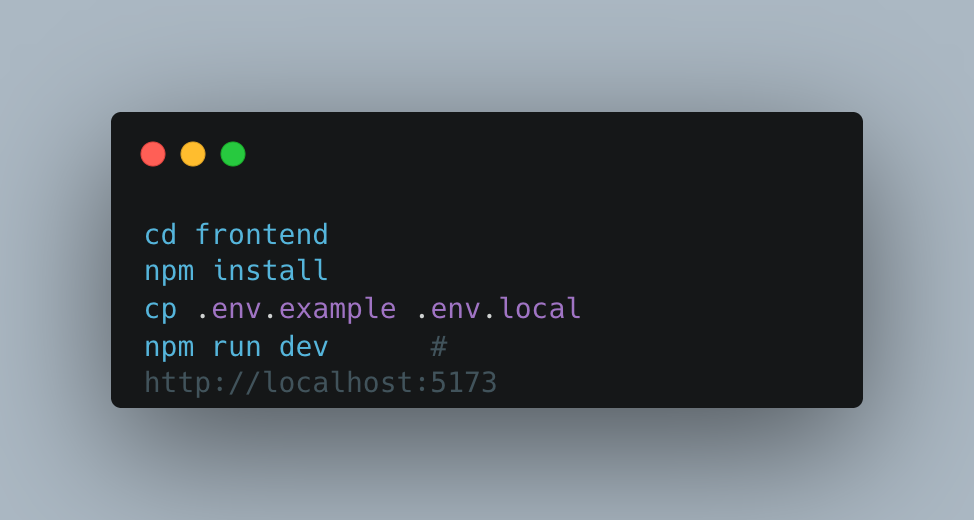
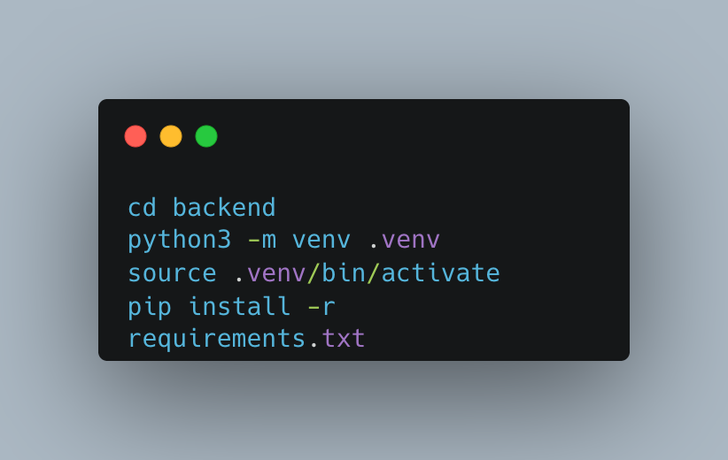
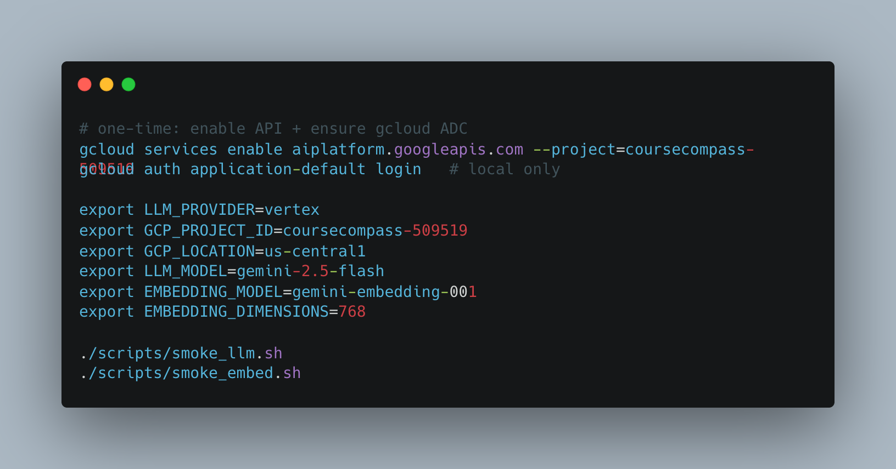
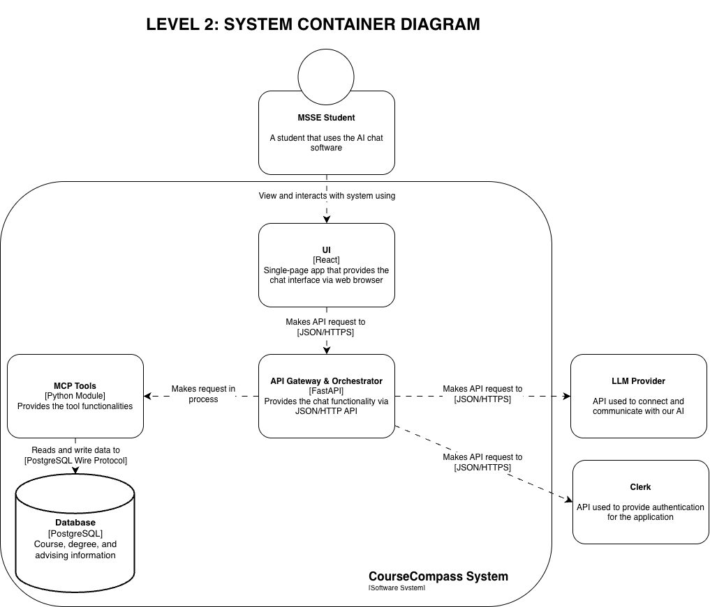
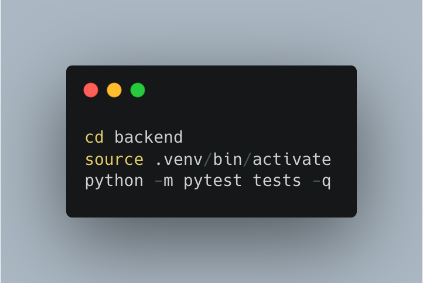

# Developer Guide

- [Development environment setup](#development-environment-setup)
- [Architecture overview](#architecture-overview-high-level-diagram--explanation)
- [Code organization](#code-organization-whats-where-and-why)
- [How to run tests](#how-to-run-tests)
- [Contribution guidelines](#contribution-guidelines-coding-standards-pr-process)

---

## Development environment setup

To get started with the CourseCompass, the following steps are needed where more details can be found in the application [Read.me](https://github.com/CourseCompassTeam/CourseCompass/tree/main):

- **Prerequisites**
  - Access privilege in GCP if you want to use gemini and embeddings
- Clone the repo at <https://github.com/CourseCompassTeam/CourseCompass>
- Gather the configurations as listed in the [configurations](https://github.com/CourseCompassTeam/CourseCompass/tree/dev#configuration) section

### Frontend setup

- Run the commands below to get the frontend started

  

- `.env.local` can be modified to determine what api is used and whether or not clerk sign in is connected

### Backend setup

- Run the commands below to get the backend started

  

- For external AI API access run these commands

  

---

## Architecture overview (high-level diagram + explanation)

- **UI** - The user interface is where the user interacts with the application and allows them to send questions to the back end and receive formatted responses
- **Gateway** - The gateway layer handles communication from the frontend to LLM provider to MCP Tools being the link that connects and passes information to each layer
- **MCP Tools** - Consists of Python modules used to interact with the database and provide the information needed for the LLM
- **Database** - Currently stores all the data used to source the AI responses. Only contains mocked student data but real MSSE course requirements and descriptions
- **LLM Provider** - The LLM provider uses two services: Vertex Gemini 2.5 Flash for tooling and phrasing and Vertext Embeddings gemini-embedding-001 for embedding interest and course text
- **Clerk** - Provides the authentication for the application, ensuring that only authorized users have access

---

## Code organization (what's where and why)

The repo is split up between two major folders with their own subfolder structure:

### Frontend

- The frontend consists of a `/src` folder that has the main src folder with 5 subfolder
  - **Src**
    - **Components** - contains all the UI component
    - **Models** - contains all the data models for the UI
    - **Services** - Provides the business logic of the UI to complete tasks
    - **Auth** - clerk root ans session wiring
    - **Styles.css** - provides all the styling for the
  - `.env.example`

### Backend

- The backend consists of 7 main subfolder each outlining the roles of those files
  - **app**
    - **Api** - lists all the endpoints
    - **Auth** - completes Clerk JWT verification
    - **Schemas** - all the requests/response models
    - **Orchestration** - contains all the orchestration layer code connecting all components
    - **Tools** - contains the mcp tools that can be called by LLM
    - **Repositories** - database layer access interfaces
    - **Ingestion** - data source ingestion interfaces
  - **Tests**
  - **tests/integration**
  - **Dockerfile**

### Extra folders

- Migrations
- Seeds
- Scripts
- docs

---

## How to run tests

### Backend tests

To run both the backend tests from the repo level directory, run these commands:

---

## Contribution guidelines (coding standards, PR process)

### Frontend

- The frontend does not follow a named style guide but maintains an established structure
  - Follow all folder structures for new files to maintain the organization of the code

### Backend

- The backend follows a Google Python Style Guide as described [here](https://google.github.io/styleguide/pyguide.html)

### PR process

- The pr process is only required when merging from dev to main
- PRs must be reviewed and approved by two other developers before merging
