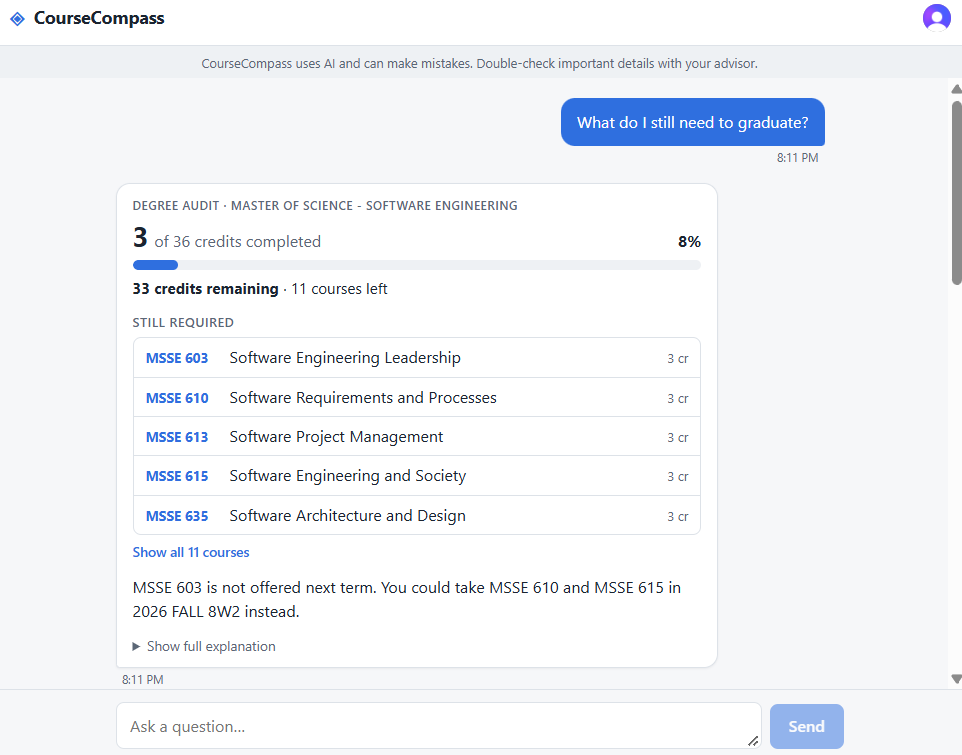
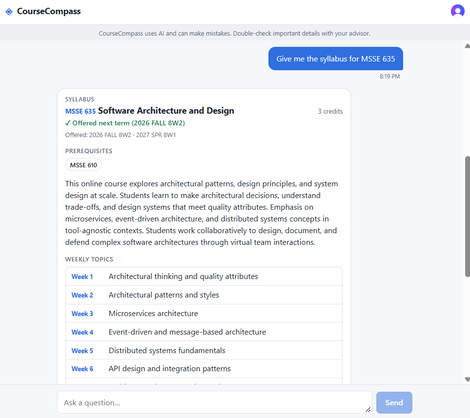

# CourseCompass User Guide

CourseCompass is an AI advising chatbot for graduate students. You ask questions in plain English about your degree progress, courses, and next steps, and it answers or points you to an advisor.

- [1. Installation and setup](#1-installation-and-setup)
- [2. How to accomplish primary tasks](#2-how-to-accomplish-primary-tasks)
- [3. Troubleshooting](#3-troubleshooting)
- [4. FAQ](#4-faq)

---

## 1. Installation and setup

Students need no installation, CourseCompass runs in a web browser.

**<https://course-compass-six.vercel.app/>**

### Accessing the app

1. Open the CourseCompass web address that’s posted above in a current version of Chrome, Edge, Firefox, or Safari.
2. Click **Sign in** and sign in or create an account through the pop-up window.
3. After sign-in, the chat screen opens with three suggested questions.

---

## 2. How to accomplish primary tasks

Every task works the same way: type a question, press <kbd>Enter</kbd>, and read the answer. Press <kbd>Shift</kbd>+<kbd>Enter</kbd> to start a new line without sending. The screenshots below use the app's sample data, so your own numbers and courses will differ.

### The chat screen

The header shows the CourseCompass name. Under it, a banner reminds you that the AI can make mistakes. Pick one of the three suggested questions or type your own in the box at the bottom.

### Task 1: Check your degree progress

1. Click **What do I still need to graduate?** or type a similar question, such as "How many credits do I have left?"
2. Read the **Degree audit** card: credits completed, a progress bar, credits remaining, and the courses still required.
3. Click **Show all** to see every remaining course, or **Show full explanation** for the written summary.

If a required course is not offered next term, the answer suggests another course you can take instead, or a link to book an advising appointment.

### Task 2: Get course recommendations

1. Ask for electives by interest, for example "Which electives fit my interest in cloud computing?"
2. Each suggested course appears as a card with its code, title, and a short description. Note that only a very limited number of elective courses are provided to the database at this time, so you will not see every course possible in the response

### Task 3: Look up a course or its syllabus

1. Ask about one course by code, for example "Give me the syllabus for MSSE 635."
2. The answer shows the credits, whether it is offered next term, prerequisites, an overview, the weekly topics, and the course objectives.
3. Click **Show AI summary** to read the written version.

### Task 4: Plan your next steps outside of class

1. Click **What are my next steps outside of class?** or type a similar question, such as “what is my next milestone?”
2. Read the checklist for your stage of the degree, shown with its credit range, and use the **Career Services** button for more help. During a longer chat, CourseCompass may also offer these steps on its own.

### Follow-up questions

CourseCompass remembers your last three questions and answers in the current chat, so you can ask "What are its prerequisites?" after asking about a course. Refreshing the page starts a new chat.

### When CourseCompass can't answer

For questions it cannot answer reliably, such as financial aid or topics outside advising, it says so and gives a button to book an advising appointment instead of guessing.

---

## 3. Troubleshooting

When something goes wrong in the chat, CourseCompass shows a red message with a hint on what to do next.

| What you see | What it means | What to do |
| --- | --- | --- |
| **"Could not reach the server."** | Your browser couldn't connect to CourseCompass. | Check your internet connection and try again. If you're on a VPN or campus network, try reconnecting. |
| **"Invalid or expired session token."** | You've been signed in too long, or your session has ended. | Sign out, sign back in, then ask your question again. |
| **"The advising model is temporarily busy. Try again in a moment."** | The AI service is getting too many requests right now. | Wait about a minute, then send your question again. |
| **"Course _XXX_ was not found."** | That course code isn't in the course catalog. | Check the course code for typos or try the course name instead. |
| **"Course _XXX_ matches more than one class: …"** | The code or name you entered matches several courses. | Ask again using one of the full course codes from the list. |
| **"No degree program was found."** | Your account isn't linked to a degree program yet, so a progress check can't run. | Contact your advisor to have your program added to your record. |
| **"An unexpected error occurred."** | Something went wrong on our end. | Try again in a moment. If it keeps happening, report it with the time it happened and the question you asked. |
| **"I can't answer that one reliably. Please contact your advisor."** _(not an error)_ | The question is outside what CourseCompass covers, or the answer couldn't be checked against the catalog. | Use the advisor or resource link shown in the reply. |
| **The Send button is grayed out** | The message box is empty, or the app is still answering your last question. | Type a question, or wait for the current answer to finish. |

---

## 4. FAQ

**Can I trust the answers?**
Use them as a starting point. CourseCompass uses AI and can make mistakes, so confirm important details, especially graduation requirements, with your advisor.

**What can I ask about?**
Degree progress, course descriptions and syllabi, which terms a course is offered, electives that fit your interests, and next steps outside of class.

**What happens when I ask something it can't answer?**
It tells you so and links to your advisor or career services instead of guessing.

**Does it remember earlier chats?**
It remembers only the last three questions and answers in the current chat. Reloading the page clears the conversation.

**Does it replace my academic advisor?**
No. It helps you prepare, and you should still confirm your plan with an advisor.
