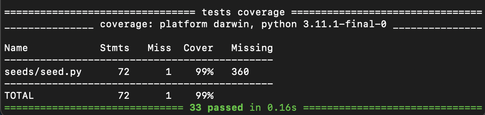
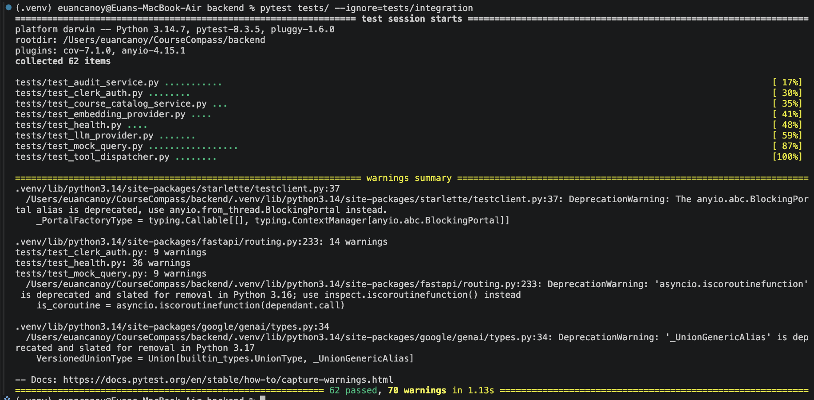
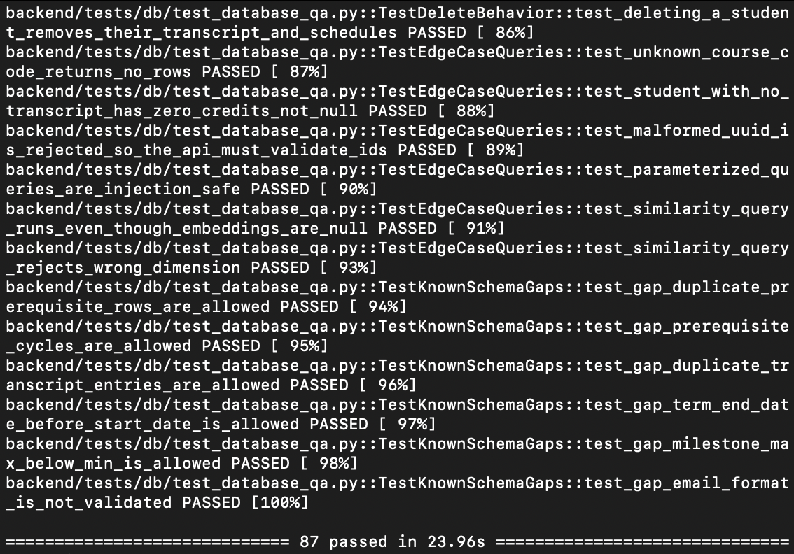
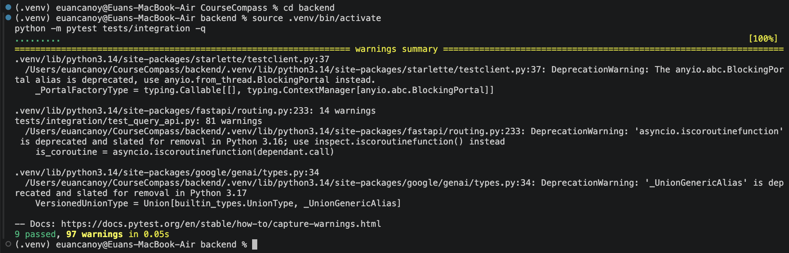
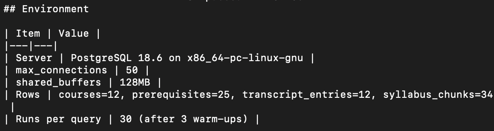
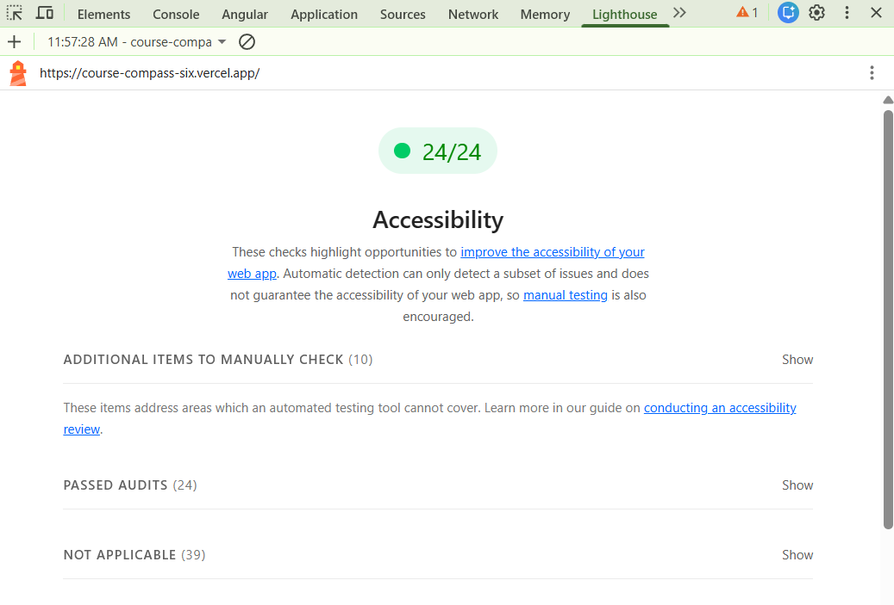
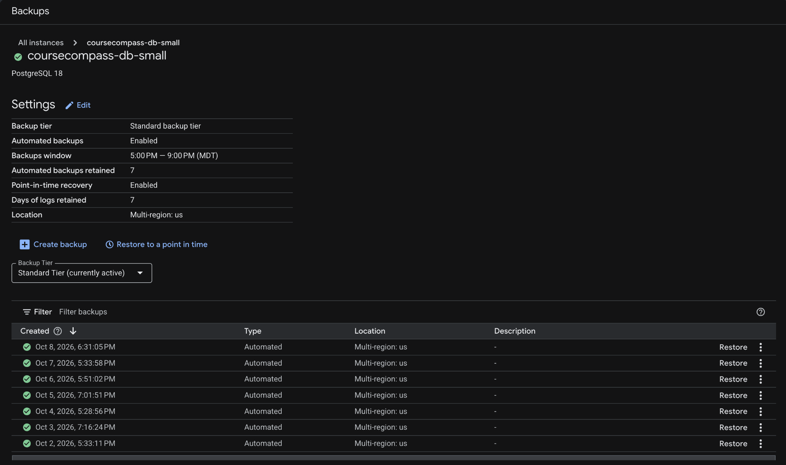

# Quality Assurance Report

**Team Production Ready**

Euan Canoy, Nhi La, Preston Davis

MSSE692_X40_Software Engineering Practicum I

Professor Morgan Worrell

October 11, 2026

---

## Table of Contents

- [I. Testing Strategy & Results](#i-testing-strategy--results)
  - [Testing approach](#testing-approach)
  - [Test coverage metrics](#test-coverage-metrics)
  - [Test results](#test-results)
  - [Integration testing](#integration-testing)
  - [User acceptance testing](#user-acceptance-testing)
- [II. Bug Report & Resolution](#ii-bug-report--resolution)
  - [Bugs discovered](#bugs-discovered)
  - [Bugs fixed](#bugs-fixed)
  - [Known issues](#known-issues)
  - [Bug triage process](#bug-triage-process)
- [III. Quality Metrics](#iii-quality-metrics)
  - [Code quality](#code-quality)
  - [Performance benchmarks](#performance-benchmarks)
  - [Security considerations](#security-considerations)
  - [Accessibility](#accessibility)
- [IV. System Readiness Assessment](#iv-system-readiness-assessment)
  - [Production readiness](#production-readiness)
  - [Stakeholder readiness](#stakeholder-readiness)
  - [Risks and mitigations](#risks-and-mitigations)
  - [Week 8 readiness](#week-8-readiness)

---

## I. Testing Strategy & Results

### Testing approach

- **Unit Testing**
  - The frontend uses unit tests written with Vitest, which was built for Vite. The tests focus on the logic that turns backend responses into what the student sees
  - Backend unit testing was used across all classes to verify the functionality of functions written
- **Integration:**
  - Integration testing was used in the backend layer of the system to verify that each layer could call one another with the appropriate external behavior being mocked
- **E2E:**
  - End to end testing was accomplished through user testing

### Test coverage metrics

- **Frontend tools**
  - Vitest
- **Frontend coverage**
  - Coverage metrics were gathered by using Vitest's V8 coverage provider (`@vitest/coverage-v8`), looking at all files in `frontend/src`

| Metric | Coverage |
|---|---|
| Lines | 54.3% (125 / 230) |
| Statements | 54.6% (131 / 240) |
| Branches | 32.1% (90 / 280) |
| Functions | 35.8% (29 / 81) |

The overall number is low because React components and auth code aren't tested. The logic layer, which was the focus, is well covered:

| Module | Line coverage |
|---|---|
| `chatService.js`, `apiClient.js`, `mockApiClient.js` | 100% |
| `chatHistory.js`, `message.js` | 100% |
| `auditSummary.js`, `errorHints.js`, `syllabus.js` | 100% |
| `FormattedText.jsx` | 82% |
| `MilestoneChecklist.jsx` | 60% |
| React components, `authService.js`, `App.jsx` | 0% |

- **Backend coverage**

| Module | Line coverage |
|---|---|
| `mock_query.py` | 91% |
| `mcp_tools.py` | 89% |
| `audit_service.py` | 87% |
| `course_catalog_service.py` | 90% |
| `student_milestone_service.py` | 96% |
| `vertex_gemini_provider.py` | 84% |
| `clerk_auth.py` | 72% |
| `query.py` API | 81% |
| `tool_dispatcher.py` | 54% |
| Postgres repositories | 24–58% |
| `intent_router.py` / `response_assembler.py` | 0% |

- **Backend tools**
  - Pytest: the test runner used for unit and integration tests
  - FastAPI: the TestClient used for HTTP calls to API
  - Unittest.mock: Used for mocking services
  - In-memory fake repositories: Used for testing access to Cloud SQL
- **Database tools**
  - Pytest: runs the tests
  - coverage.py: measures the code coverage of `seeds/seed.py`, the only Python in the database layer

### Test results

#### Frontend Unit Tests

- 40 tests in 9 test files, all passing (100%)
- Example tests consist of:
  - "parses the standard error envelope" - verifies that a failed backend response becomes an ApiError carrying the backend's error code, message, and details
  - "reports an unreachable server as a network error" - ensures that when the server can't be reached, the student gets a NETWORK_ERROR with a connection hint instead of a crash
  - "treats an unknown response type as a redirect (QA-02)" - ensures that a response type the UI doesn't recognize is shown as a redirect to an advisor rather than an unverified answer
  - "computes progress and adds course titles" - verifies the degree audit's credit progress percentage and that remaining course codes are shown with their course titles

#### Backend Unit Tests

- The backend consists of 62 unit tests across the entire suite
- Out of those 62 tests, 100 % tests passed
- Example tests consist of:
  - `test_audit_when _only_final_course_remains` - verifies the credits remaining and missing courses are only 692
  - `Test_696_is_offered_only_after_692_starts` - ensures that 696 is only offered as an option after 692 is started or enrolled
  - `test_syllabus_text_ranks_a course_the_description_misses` - scores courses based on "penetration testing" interest and returns the sorts classes according to the best score
  - `Test_choose_tool_hallucinated_student_id` - ensures that a student id is not passed with the response from the LLM

Evidence of tests running:

#### Schema Validation, Migration Tests, and Persistence

- 87 database tests against the live CloudSQL instance
  - 87 passes, 100% in 23.96 seconds
- 33 unit tests of the seed script
  - 33 passes, 100%, in 0.16 seconds
- Example test case
  - `test_foreign_keys_and_delete_rules`: all 14 foreign keys exist with the intended delete rule
  - `test_database_rejects_bad_data[prerequisite_self_reference]`: a course cannot be its own prerequisite
  - `test_parameterized_queries_are_injection_safe`: an injection attempt returns no rows and leaves the courses table intact
  - `test_cannot_delete_program_that_has_students`: RESTRICT blocks deleting a program that has students
  - `test_no_duplicate_rows_when_everything_already_exists[prerequisites]`: a second seed run inserts no duplicate prerequisite rows

Evidence for 87 database tests passed:

### Integration testing

API Integration testing suite tests the integration between each component and external service used within the backend

- There are 9 main integration scenarios tested in our API suite.
- Out of the 9 scenarios, there is a 100% passing rate
- The scenarios tested are
  - `test_health_with_tool_stack_attached` - Verifies that the application is up and returns a 200 if it is healthy
  - `test_audit_uses_dev_student_identity` - Completes the audit for a nearly done student
  - `test_course_description_returns_recommendation_card` - Verifies that the the course details for MSSE 692 is returned
  - `test_next_course_question_forces_audit` - Verifies if a LLM redirects for "What course should I take next" an audit is still ran
  - `test_history_follow_up_resolves_this_course` - Completes the follow up question workflow asking if the course is "offered next term", ensuring that a recommendation is offered for next term
  - `test_syllabus_follow_up_sets_summary_flag` - Tests that the system provides more detailed information from syllabus when following up on course
  - `test_out_of_scope_returns_redirect` - Ensures that a financial aid question is redirected to advising url
  - `Test_internal_dump_request_is_refused` - Verifies that prompt injecting is not used to obtain tool information
  - `test_just_started_student_sees_more_remaining` - Completes audit and verifies the courses needed for just started student

Evidence of tests running:

### User acceptance testing

We reached out to 3 external stakeholders so they could test our application and provide valuable feedback, but we are still waiting on a response from each of them. In the meantime, the development team has completed internal user testing.

---

## II. Bug Report & Resolution

### Bugs discovered

**P0**

- Prompt Injection: A query using "Maintenance mode" enabled the system to return the last tool JSON used

**P1**

- None

**P2**

- Limited chat history: All chats only pass along the last 3-4 messages, but that is a feature that we limited to provide the performance needed for the system
- Follow-up question hiding summary: A degree audit follow-up question shows the audit again while hiding the new AI summary that answers the question
- Stubbed resources: As most of our student data contain mock user information, we also stubbed the advising and career services resources and contact information
- Course found by course code only: Courses are found only by full code. "What is the software architecture course about?" returns 404 Not Found

**P3**

- None

Overall, no major bugs were discovered during our use and testing. Prompt injection was discovered during implementation and was immediately patched. All P2 bugs do limit user experience but do not stop the system from accomplishing the core behavior expected.

### Bugs fixed

**Prompt Injection Dumping Tools Fix:** To ensure that we do not dump tools used or JSON being emitted, we enforced a 3-layer protection.

- **Phrasing Rules** - prompts that contain studentQuery and conversationHistory are not trusted, and no output from the model should contain any confidential information or be redirected
- **Skip the model for dump requests** - Questions that match patterns of dumping do not allow for a phrase_response
- **Safety net if model leaks** - If replies contain the internal fields leaking information, then the text is replaced with advising redirect instead

### Known issues

All our P2 bugs were left unfixed.

- **Limited chat history**
  - Impact: User cannot follow up on the same question as asked 3 chat messages ago due to limited history. While it will show in the user interface, not all messages are passed in the query.
  - Workaround: Keep conversations limited or continue to follow up in 4 questions max
- **Follow-up question hiding summary**
  - Impact: User does not immediately see the AI summary without the extra step of clicking on the dropdown
  - Workaround: User can just click on the clearly labeled dropdown tab if they need a deeper explanation of the response
- **Stubbed resources**
  - Impact: User cannot access true advising or career service resources
  - Workaround: As this is a prototype, there is no workaround to direct students to the actual resources. The user can only find those resources themselves, but they can have some course questions answered by the chat if needed.
- **Course found by course code only**
  - Impact: The user won't be able to receive a response about a course unless they provide the course code
  - Workaround: The user will have to ask about a course by the code, or wait until the course code and name appear together in the chat history, and then they can reference the course by name only since the LLM will have a reference to go off of.

### Bug triage process

Bugs were fixed in order of priority level, and if they weren't higher than a P2 they weren't fixed. We made this decision so that we could focus our time on documentation and other quality assurance efforts.

---

## III. Quality Metrics

### Code quality

#### Database Code Quality

- Linting and complexity were measured on the database layer's Python: `seeds/seed.py` and the three scripts in the `backend/tests/db/`
- Tool
  - ruff 0.17.0
    - First run: 16 style findings and none of the serious kind (no unused imports, undefined names, or syntax problems): 6 nested with-statements, 6 unparenthesized implicit string joins, 2 zip calls that should use pairwise, and 2 minor items
    - 15 were fixed in the test scripts; 1 remains in `seeds/seed.py` left unchanged because it does not change behavior
  - Radon, cyclomatic complexity
    - 131 blocks: 127 rated A, 3 rated B, 1 rated C
  - Radon, maintainability
    - Every file is rated A

### Performance benchmarks

#### E2E Performance Benchmarks:

| Scenario | Response Time | Notes |
|---|---|---|
| What do I still need to graduate? | 7 seconds on average | 5 attempts, with startup being the slowest at 10 seconds |
| Which electives fit my interest in cloud computing? | 8 seconds on average | 5 attempts |
| What are my next steps outside of class? | 4 seconds on average | 5 attempts |

#### Database Performance Benchmarks:

- 30 runs per query after 3 warm-ups

| Query | Client median (ms) | Client p95 (ms) | Server median (ms) | Scan type |
|---|---|---|---|---|
| Course lookup by code | 37.1 | 211.3 | 0.049 | Seq Scan |
| Credits completed for a student | 37.2 | 75.7 | 0.147 | Index Scan |
| Remaining required courses (audit) | 37.2 | 44.3 | 0.143 | Index Scan |
| Prerequisites of a course | 36.9 | 44.0 | 0.125 | Seq Scan |
| Missing prerequisites for a student | 37.5 | 70.8 | 0.172 | Seq Scan |
| Courses offered in a term | 37.1 | 76.2 | 0.124 | Seq Scan |
| Syllabus chunks for a course | 39.0 | 210.6 | 0.098 | Seq Scan |

### Security considerations

#### Frontend Security Considerations:

- **Authentication with Clerk:** Students must sign in through Clerk before they can use the chat. Passwords and sign-in are handled entirely by Clerk, so the frontend never sees or stores them
- **Token-based API calls:** Every request to the backend carries the student's short-lived Clerk session token as a Bearer token, which is verified by the backend
- **No secrets in the browser:** The only key the frontend uses is Clerk's publishable key, which is meant to be public. Environment files are git-ignored, and `.env.example` warns not to put secret keys in `VITE_` variables, since Vite exposes those to the browser
- **No stored chat data:** Conversations are kept only in memory while the page is open. Nothing is saved to localStorage or cookies, so closing the tab clears them

#### Backend Security Considerations:

- **Prompt Injecting Prevention:** We tried to protect against any malicious users to not take advantage of the LLM to grant them access information that should not be offered by the system.
- **Streamlined Scope:** The system is structured to only answer advising questions using the backing of data that is stored within our database. Any unrelated questions or those that cannot be answered by our database make students follow up with an advisor
- **Protecting Personal Information:** No personal information like student id is passed to the LLM or returned in responses

#### Database Security Considerations:

- The seed script refuses to run in production
- The LLM can only call a fixed set of tools, and only the repository layer touches PostgreSQL

### Accessibility

Here are the results of running a basic Lighthouse accessibility audit within Chrome DevTools:

---

## IV. System Readiness Assessment

### Production readiness

#### Current State of the Application

The application is in a state that can be deployed to production but does not have the capabilities to serve a wide audience. It is limited to the seeded student data that exists within our databases. While this can display the ability of our features, we do not have access to live student data or the option to upload student data so that responses are personalized to them.

#### Next Steps

The next steps of the application are to work on adding more courses and degree options as well as the ability to safely upload or provide access to real student data. This will allow the system to provide personalized responses and solve real-world problems and questions for users.

### Stakeholder readiness

The application in its current state is not ready for full stakeholder usage. Prototype usage is allowed to answer a limited set of scenarios. For documentation and training, users are not required to review them before use and are free to ask any questions. It is recommended to understand what scenarios can be answered by the chat so users can make the most of their experience with the application.

### Risks and mitigations

The current application has limited scope and access with stubbed data and course information that is only kept within our database resources. Meaning that the application should not be able to share any dangerous or confidential information. The only major risk is the limited testing that has occurred with the application. Within our use the LLM has provided accurate enough responses with the two different students we have mocked. We cannot ensure if every MSSE student can use this application without any errors. Given the use of an LLM in our application there will always be a potential risk with it failing and not being correct. A disclaimer is always provided at the top of the application for students to verify responses by themselves, advisors, or career services.

Our database is automated backups and point-in-time recovery are enabled:

### Week 8 readiness

For week 8, all of our work has been completed for a functioning prototype application. We just need to get all our documents polished and organized in preparation for stakeholder handoff.
